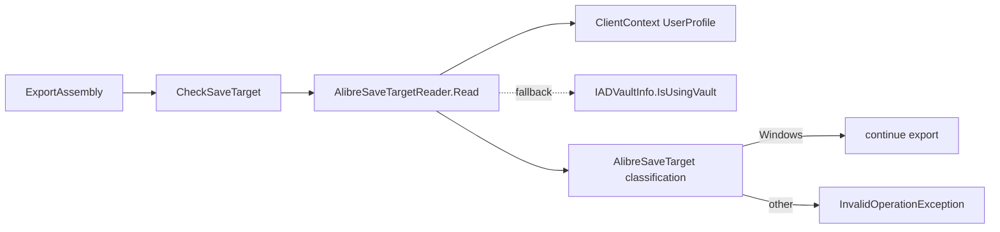

# Requirements

### Overview & Goals
`AlibreGearExporter.IsUsingVault()` (Gears\Calculator\Alibre\AlibreGearExporter.cs, ~line 1036) only reads `IADRoot.VaultInfo.IsUsingVault`. It does not detect Alibre being set to save to a **PDM repository**, which is a different save target from the Vault. `ExportAssembly` (~line 898) therefore lets an export run while PDM saving is on, and it fails or misbehaves because parts are saved to a Windows folder and then added to the assembly.

Goal: replace `IsUsingVault()` with a test of the **configured save target** taken from Alibre's own user profile. The only safe target is `SaveWorkspaceMediator.SAVE_TARGET_WINDOWS`; every other target (Vault, PDM repository, AD repository, unknown) is refused with a clear message.

### Scope
**In scope**
- A save-target reader that uses `ClientContext.Singleton.UserProfile` and the `SaveWorkspaceMediator.SAVE_TARGET_*` constants (`alibre-client.dll`).
- Replacing the `IsUsingVault()` call in `ExportAssembly` with the new check and a per-target error message.
- Unit tests for the classification and message logic, which need no running Alibre.
- A short documentation note in Writerside if the Alibre export topic mentions the Vault check.

**Out of scope**
- Changing Alibre's save option (the API cannot do it).
- The untracked leftovers of an earlier attempt (`AlibreAssemblyPartExporter.cs`, `AlibreSaveMode.cs`, `Tools\AlibrePatternProbe`, `.junie\plans\export-all-to-alibre-pdm.md`). They do not compile against the committed exporter and are not touched.
- Building parts in place inside an assembly for PDM.

### User Stories
- As a gear designer, I want the assembly export to stop with a clear message when Alibre saves to PDM, so that I do not get a confusing failure halfway through.
- As a gear designer using the Vault, I still want the same refusal, now naming the target.

### Functional Requirements
- The export proceeds only when the configured save target is Windows.
- Vault, PDM repository, AD repository and unknown targets throw `InvalidOperationException` before anything is created in Alibre. The message names the target and tells the user to switch the system option to the Windows file system.
- If the profile value is missing or unreadable, fall back to `IADVaultInfo.IsUsingVault`: true means Vault, false means Windows. The fallback is logged in `export.log`.
- `GearTrainForm.ExportAssemblyToAlibre` already shows the exception message in the status line and a message box, so no UI change is needed.

### Non-Functional Requirements
- The code stays .NET Framework 4.8.1 and LangVersion 10 compatible.
- Classes from `alibre-client.dll` are confined to one small method so the pure logic runs in NUnit without Alibre loaded.

# Technical Design

### Current Implementation
- `AlibreGearExporter.ExportAssembly` (line ~882) first runs `stage = "checking the Alibre save location"; if (IsUsingVault()) throw ...` (lines ~897-904).
- `IsUsingVault()` (line ~1036) returns `_root.VaultInfo.IsUsingVault` and returns false on any exception, so an unreadable option is silently treated as safe.
- Gears, GearsUI, GearsAddOn and UnitTests reference only `AlibreX.dll` and `AlibreAddOn.dll` (`..\..\..\..\AlibreLib`, i.e. `D:\AlibreLib`). None reference `alibre-client.dll`.
- Findings from reflecting over `D:\AlibreLib\alibre-client.dll`:
  - `com.alibre.engineering.client.SaveWorkspaceMediator` has `public static readonly short` fields (not compile-time constants): `SAVE_TARGET_UNKNOWN`=0, `SAVE_TARGET_WINDOWS`=1, `SAVE_TARGET_VAULT`=2, `SAVE_TARGET_AD_REPOSITORY`=3, `SAVE_TARGET_PDM_REPOSITORY`=4, and `DEFAULT_SAVE_TARGET_KEY`="default_save_target".
  - `com.alibre.client.ClientContext.Singleton` is a public static property; the instance has `UserProfile` of type `com.alibre.utils.Profile`, with `object getValue(string path)`.
  - `IUserProfileKeys.DEFAULT_SAVE_TARGET_KEY` is "default_save_target"; `vault_selected` and `pdm_safe_selected` are other related keys.

### Key Decisions
1. **Read the target from the user profile.** `ClientContext.Singleton.UserProfile.getValue(SaveWorkspaceMediator.DEFAULT_SAVE_TARGET_KEY)`, converted with `Convert.ToInt32`. The code compares against the `SaveWorkspaceMediator.SAVE_TARGET_*` fields at run time rather than hard-coded numbers, because they are `static readonly`.
2. **Whitelist, not blacklist.** Only `SAVE_TARGET_WINDOWS` passes. This follows the issue text: the only safe target is Windows.
3. **Isolate the Alibre client dependency.** A new `AlibreSaveTargetReader` holds the only references to `alibre-client.dll` types, in one method. The classification and message are pure functions of an integer and a codes table, so unit tests never load `alibre-client.dll` (which pulls in DevExpress and other Alibre libraries).
4. **Fallback when unreadable.** If the profile or key cannot be read (add-in context not initialised, null value, `FileNotFoundException`/`TypeLoadException`), use `IADVaultInfo.IsUsingVault` and log it, instead of failing silently. An unknown target code, or no readable source at all, is refused with an explanatory message.

### Architecture Diagram


### Proposed Changes
- Replace the `IsUsingVault()` check in `ExportAssembly` with a private `CheckSaveTarget(List<string> log)` that calls the reader, appends a `save target: <name> (<source>)` line to the export log, and throws for any target other than Windows. Remove `IsUsingVault()`, or keep it only as the reader's fallback input.
- Add the reader and types listed under Data Models / Contracts.
- Add `<Reference Include="alibre-client">` with `HintPath ..\..\..\..\AlibreLib\alibre-client.dll` to `Gears\Gears.csproj` (set `<Private>False</Private>` so it is not copied beside Gears; Alibre supplies it). Add the new files to the `Compile Include` list in that csproj, which uses explicit includes. UnitTests needs no new reference if the logic types do not expose `alibre-client` types.

### Data Models / Contracts
New file `Gears\Calculator\Alibre\AlibreSaveTarget.cs`:
```csharp
public enum AlibreSaveTarget { Unknown, Windows, Vault, AdRepository, PdmRepository }

/// <summary>The numeric values of SaveWorkspaceMediator.SAVE_TARGET_*.</summary>
public sealed class SaveTargetCodes
{
    public SaveTargetCodes(int windows, int vault, int adRepository, int pdmRepository) { ... }
    public static SaveTargetCodes Documented { get; } // 1, 2, 3, 4 (verified in alibre-client.dll)
}
```
New file `Gears\Calculator\Alibre\AlibreSaveTargetReader.cs`:
```csharp
public static class AlibreSaveTargetReader
{
    public static AlibreSaveTarget Classify(int code, SaveTargetCodes codes);   // pure
    public static bool IsSafe(AlibreSaveTarget target);                           // Windows only
    public static string DescribeRefusal(AlibreSaveTarget target);               // pure, per-target message
    public static AlibreSaveTarget Read(IADRoot root, out string source);        // profile, else VaultInfo fallback
    private static bool TryReadProfile(out int code, out SaveTargetCodes codes);  // only place that touches alibre-client types
}
```
`TryReadProfile` is marked `[MethodImpl(MethodImplOptions.NoInlining)]` and catches `Exception` (including `FileNotFoundException` and `TypeLoadException`), so a missing library cannot crash the caller.

### Risks
- `ClientContext.Singleton` may not be initialised or may sit in another AppDomain when the exporter runs outside the Alibre process (for example the probe tool). The fallback to `IADVaultInfo.IsUsingVault` and the logged source line cover this.
- A missing `default_save_target` key may mean "never changed, default". It is treated as unreadable, so the `IsUsingVault` fallback decides; this is logged.
- `alibre-client.dll` is not in the repository; the HintPath depends on the `D:\AlibreLib` layout the other Alibre references already use.
- The untracked `AlibreAssemblyPartExporter.cs` references members that do not exist in the committed exporter. If it stays in the working tree, the Gears project does not include it (explicit `Compile Include`), so the build is unaffected.

# Testing

### Validation Approach
Build the solution, then run the NUnit tests for the new pure logic. Reading the real profile needs a running Alibre, so it is not covered by automated tests.

### Key Scenarios
- `Classify(1)` is Windows and `IsSafe` is true.
- `Classify(2)` is Vault, `Classify(4)` is PdmRepository and `Classify(3)` is AdRepository; all are unsafe.
- `Classify(0)` and an out-of-range code such as 99 are Unknown and unsafe.
- `DescribeRefusal` for Vault and PDM repository names the target and tells the user to switch to the Windows file system; the two messages differ.

### Edge Cases
- `SaveTargetCodes.Documented` equals the values found in `alibre-client.dll` (0 to 4), so the fallback table stays in step with Alibre.
- `ExportAssembly` still throws `InvalidOperationException` for fewer than the minimum parts before any save-target check, so the existing `TestAlibreAssemblyExport` tests are unchanged.

### Test Changes
- Add `UnitTests\TestAlibreSaveTarget.cs`, an NUnit fixture mirroring `TestAlibreAssemblyExport.cs` style, with the cases above.
- No existing tests are removed. Manual check, if Alibre is available: with Windows saving the export runs; with Vault or PDM it stops with the new message.

# Delivery Steps

### ✓ Step 1: Add save-target model and reader with unit tests
The Gears project has a tested way to classify Alibre's configured save target, with only Windows counted as safe.

- Add `Gears\Calculator\Alibre\AlibreSaveTarget.cs` with the `AlibreSaveTarget` enum and `SaveTargetCodes` (documented values 1/2/3/4).
- Add `Gears\Calculator\Alibre\AlibreSaveTargetReader.cs` with the pure `Classify`, `IsSafe` and `DescribeRefusal` functions.
- Register both files in the `Compile Include` list of `Gears\Gears.csproj`.
- Add `UnitTests\TestAlibreSaveTarget.cs` covering Windows, Vault, PDM repository, AD repository, unknown and out-of-range codes, and the refusal messages.

### ✓ Step 2: Read the configured target from ClientContext.UserProfile
The reader can fetch the real configured save target from Alibre's user profile and falls back safely.

- Add the `alibre-client` reference to `Gears\Gears.csproj` (HintPath `..\..\..\..\AlibreLib\alibre-client.dll`, `Private` False).
- Implement `TryReadProfile` as the only code that touches `ClientContext.Singleton.UserProfile.getValue(SaveWorkspaceMediator.DEFAULT_SAVE_TARGET_KEY)` and the `SAVE_TARGET_*` fields, marked no-inlining and wrapped in exception handling.
- Implement `Read(IADRoot, out string source)`: use the profile value when readable; otherwise fall back to `_root.VaultInfo.IsUsingVault` (Vault or Windows) and report the source as the fallback.
- Build the solution and confirm the Gears and UnitTests projects compile.

### ✓ Step 3: Replace IsUsingVault in ExportAssembly with the save-target check
`ExportAssembly` refuses to run unless Alibre is set to save to Windows, and says which target is configured.

- In `AlibreGearExporter.cs` add private `CheckSaveTarget(List<string> log)`, which calls `AlibreSaveTargetReader.Read`, logs `save target: <name> (<source>)`, and throws `InvalidOperationException(DescribeRefusal(target))` for any target other than Windows.
- Replace the `if (IsUsingVault()) throw ...` block (stage "checking the Alibre save location", ~line 898) with the new call, and remove the old `IsUsingVault()` method (~line 1036).
- Update the XML docs of `ExportAssembly` to mention the Windows-only requirement.
- Update the Writerside Alibre export topic if it describes the Vault check.
- Build the solution and run `UnitTests` (including `TestAlibreAssemblyExport` and `TestAlibreSaveTarget`) to confirm nothing regressed.