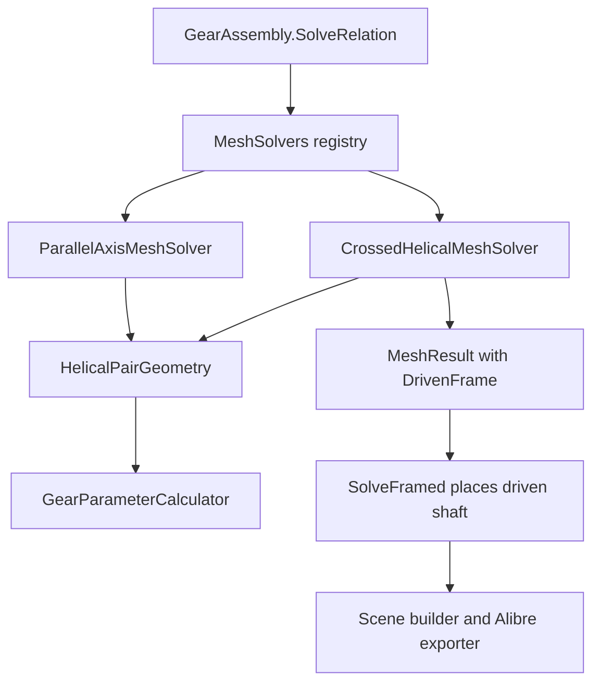

# Requirements

### Overview & Goals
Helical gears can mesh on shafts that are not parallel, and the two gears can have different helix angles. The reference case is a 24-tooth 26.6° helical gear driving a 12-tooth 63.4° helical gear on shafts at 90°. Both have the same hand and the same normal module. The assembly places the driven shaft at the right angle and distance, the 3D scene and the Alibre export show it, and the speed ratio is 2:1.

### Scope
**In scope**
- A new `MeshType.CrossedHelical` with its own solver, an optional shaft angle on the relation, and validation of that angle against the helix angles and hands.
- Per-gear transverse geometry (each gear has its own transverse module and pitch diameter), shared by the parallel and crossed solvers.
- Saving and loading the shaft angle.
- Adding the mesh in the gear train editor.
- Alibre export placement of both gears.
- Tests and a `Writerside` note.

**Out of scope**
- Herringbone, internal and rack helical gears on crossed shafts.
- Profile-shifted crossed pairs. Profile shift stays 0, and other values are rejected with a message.
- Bevel, worm and cycloidal meshes.
- Contact ratio and load calculations for crossed helical gears. They have point contact, and the report says so.
- Planetary sets.
- `AssemblyInfo.cs`.

### Done when
- A `MeshType.CrossedHelical` relation with shaft angle 90° between `InvoluteGearComponent` 24T/26.6° and 12T/63.4° (same hand, same module) solves. The driven shaft axis is 90° to the driver axis, the shafts are `(d1 + d2) / 2` apart, and `GearTrainAnalyzer.SpeedFactor` is 12/24 in magnitude.
- A shaft angle that does not match the helix angles and hands (for example 80° for the pair above) is rejected with a message that gives the expected angle.
- A parallel relation between gears with different helix angles is rejected with a message that points to the crossed mesh. Existing parallel pairs behave as before.
- The saved file keeps the shaft angle. Older files load unchanged.
- `UnitTests` is green with a non-zero executed-test count that includes the new tests.

# Technical Design

### Current Implementation
- `ParallelAxisMeshSolver.Solve` (`Gears\Calculator\Assemblies`) calls `GearParameterCalculator.CalculatePair` and returns a `MeshResult` with no frame. `GearAssembly.SolveRelation` then puts the driven shaft parallel to the driver at the centre distance. It does not check that the helix angles are equal or the hands opposite.
- `CalculatePair` (`Gears\Calculator\GearParameterCalculator.cs`) takes the transverse module and pressure angle from gear 1 only. The centre distance is `mt * sumZ / 2`, and the axial contact ratio uses `beta1`. This is correct only for equal helix angles. For 26.6° and 63.4° it gives a wrong distance, because the pitch diameter is `z * mn / cos(beta)` for each gear separately.
- Worm and bevel meshes return `MeshResult.DrivenFrame` (`WormMeshSolver`, `BevelMeshSolver`). `GearAssembly.SolveFramed` places the driven shaft from that frame after the line-of-centres turn `RotationZ(theta)` and sets `Shaft.RotationRad`. `GearAssemblySceneBuilder` and `AlibreGearExporter.GetPartPlacement` already place parts from `shaft.Placement` and the mount phase, so an angled shaft needs no change there.
- `MeshSolvers` maps each `MeshType` to a solver. `GearTrainAnalyzer.SpeedFactor` and `GearParameterTables` go through the solver and `MeshResult.PairData`, so they work with a new solver unchanged.
- `IAdjustableCentreSolver` is the existing pattern for a solver that needs one more input than `IMeshSolver.Solve`. `AssemblySerializer` reads `RelationDto.MeshType` with `Enum.TryParse`, plus `CentreLineAngleDeg` and `CentreDistance`.

### Key Decisions (confirmed with the user)
- A new `MeshType.CrossedHelical` with a separate `CrossedHelicalMeshSolver`. The parallel solver keeps its role. Worm and bevel already follow this pattern, and the existing parallel tests stay untouched.
- A shared per-gear pair-geometry helper that both solvers use. `CalculatePair` stops reading gear 1's helix angle for gear 2.
- The shaft angle is entered by the user on the relation and validated against the helix angles and hands. It is not silently derived. The editor pre-fills the derived value for a new crossed mesh.

### Geometry
- Per gear: transverse module `mt_i = mn / cos(beta_i)`, pitch diameter `d_i = z_i * mt_i`. The gears share the normal module and normal pressure angle.
- Centre distance `a = (d1 + d2) / 2` (profile shift 0).
- Expected shaft angle: `Sigma = beta1 + beta2` for the same hand, `|beta1 - beta2|` for opposite hands. For 26.6° and 63.4° with the same hand, `Sigma = 90°`. With equal angles and opposite hands, `Sigma = 0`, which is the parallel mesh.
- The speed ratio is `z1 / z2` in magnitude, not `d1 / d2`. In the reference case `d1 = d2` while the ratio is 2:1. Nothing may derive the ratio from the diameters.
- Driven frame in the driver frame (line of centres along +X, as in `BevelMeshSolver`): origin `(a, 0, 0)`, Z axis `(0, -sin Sigma, cos Sigma)`, X axis `(1, 0, 0)`. `SolveFramed` then applies `RotationZ(theta)`, so `CentreLineAngleDeg` still works. The sign of the rotation about X and the sign of the speed factor follow from the tooth-contact condition (same helix tangent at the contact point, equal surface velocity along the tooth normal). Tests fix them.
- Phase: at phase 0 a tooth space of the driven gear is centred on the contact point on its mid-plane, in the way `WormMeshSolver` and `ParallelAxisMeshSolver.basePhase` do it. Crossed helical teeth touch at a point, so the phase only has to avoid interference there. A test checks it.

### Data Models / Contracts
- `GearMeshRelation.ShaftAngleDeg` (double, default 0), used only by `CrossedHelical`. `GearAssembly.AddRelation(driver, driven, meshType, centreLineAngleDeg = 0.0, shaftAngleDeg = 0.0)`.
- `ICrossedAxisSolver : IMeshSolver` with `MeshResult Solve(GearComponent driver, GearComponent driven, double driverPhaseRad, double shaftAngleDeg)`. `GearAssembly.SolveRelation` calls it when the solver implements it, like `IAdjustableCentreSolver`. A centre distance override is rejected for this mesh type, as for worm and bevel.
- `RelationDto.ShaftAngleDeg` (double, optional, default 0), so older files load unchanged.
- `CalculatedGearPairData` gets `ShaftAngleDeg` and `IsCrossedAxis`. `GearParameterCalculator.CalculateCrossedPair(...)` returns rows for both transverse modules, both pitch diameters, the centre distance, the shaft angle and a "point contact" note. The contact ratio stays 0.
- Shared helper `HelicalPairGeometry` (new, `Gears\Calculator`): per-gear transverse module and pitch diameter, `ExpectedShaftAngleDeg(beta1, dir1, beta2, dir2)`, and the centre distance.

### File Structure
- Added: `Gears\Calculator\HelicalPairGeometry.cs`, `Gears\Calculator\Assemblies\CrossedHelicalMeshSolver.cs`, `Gears\Calculator\Assemblies\ICrossedAxisSolver.cs`, `UnitTests\TestCrossedHelicalMesh.cs`. Each needs a `<Compile Include>` entry in the old-style `Gears.csproj` or `UnitTests.csproj`.
- Modified: `GearParameterCalculator.cs`, `ParallelAxisMeshSolver.cs`, `MeshSolvers.cs`, `GearMeshRelation.cs`, `GearAssembly.cs`, `AssemblySerializer.cs`, `GearsUI\Gui\Presenters\GearTrainPresenter.cs`, `GearsUI\Gui\Presenters\TrainNodeProperties.cs`, `GearsUI\Gui\Views\GearTrainForm.cs`, `Writerside\topics\gear-assemblies.md`.

### Architecture Diagram

### Risks
- Existing parallel tests or saved files may use different helix angles on a parallel pair, and the new parallel validation could fail them. Mitigation: run the suite first. If tests break, make the check a reported warning and list the affected tests.
- The helix hand and the twist direction in `GearMesh3DBuilder` fix which sign of `Sigma` is right. A wrong sign gives a mesh that looks fine but has teeth at the wrong slope. Mitigation: a geometric test checks that the helix tangents of both gears at the contact point are the same line in world coordinates.
- `CalculatePair` is used by the parallel solver and the UI tables. Its refactor must give identical numbers when both helix angles are equal. Existing tests cover this.
- Axial offsets: the contact point sits on the common normal at both mid-planes. A crossed pair with different axial offsets needs a test.

# Testing

### Validation Approach
Use the Rider test runner, not `dotnet test`. `UnitTests` is a legacy net481 NUnit 3.5 project. Select new files by path, and check that the executed count is non-zero and includes the new tests.

### Key Scenarios
- **Reference case**: 24T 26.6° and 12T 63.4°, both right hand, normal module 2, pressure angle 20°. Check the pitch diameters (both about 53.67 mm), the centre distance, the shaft angle of 90°, a `SpeedFactor` magnitude of 0.5, and the solved frame.
- **Geometry**: the helix tangents of both gears at the contact point are the same line in world coordinates. The surface velocity components along the tooth normal are equal, which fixes the sign of the speed factor.
- **Other angles**: 20° and 30° helix on shafts at 50° (same hand) and at 10° (opposite hands), and 45°/45° at 90°.
- **Assembly**: `CentreLineAngleDeg` of 0, 30 and -45 work. A gear driven from the crossed gear's shaft is placed correctly.
- **Save and load**: a round trip keeps `ShaftAngleDeg` and the mesh type. An older file without the field loads.
- **Scene and export**: scene polylines and `GetPartPlacement` agree for both gears at a non-zero driver rotation, as in `TestAlibrePartPhase.cs`.

### Edge Cases
- A shaft angle of 80° for the reference pair is rejected with the expected angle in the message.
- Different modules, different pressure angles, internal gears, herringbone gears and a non-zero profile shift are rejected.
- A parallel relation with different helix angles is rejected with a message that names the crossed mesh.
- A centre distance override on a crossed relation is rejected.

### Test Changes
- Add `UnitTests\TestCrossedHelicalMesh.cs`.
- Regression suites to keep green: `TestGearTrain.cs`, `TestGearTrainPhases3To7.cs`, `TestGearTrainEditorPhases3To7.cs`, `TestAlibrePartPhase.cs`, `TestAlibreAssemblyExport.cs`, `TestAlibreRackWormExport.cs`, `TestBevelGearTypes.cs` and the helical gear tests.

# Delivery Steps

### ✓ Step 1: Per-gear transverse geometry and crossed pair calculation
The pair calculator gives correct pitch diameters, centre distance and shaft angle for gears with different helix angles, and the parallel path is unchanged.

- Add `Gears\Calculator\HelicalPairGeometry.cs` with per-gear transverse module and pitch diameter, `ExpectedShaftAngleDeg` and the centre distance.
- Refactor `GearParameterCalculator.CalculatePair` to use per-gear transverse values, so equal helix angles give the same numbers as before.
- Add `CalculateCrossedPair`, plus `ShaftAngleDeg` and `IsCrossedAxis` on `CalculatedGearPairData`. The contact ratio stays 0, and a "point contact" note is added.
- Add validation in `ParallelAxisMeshSolver` that rejects different helix angles or the wrong hands, with a message that names the crossed mesh. If existing tests break, make it a warning and list them.
- Reject different modules, different pressure angles, internal gears and non-zero profile shift for the crossed calculation.
- Add the calculation tests in new `UnitTests\TestCrossedHelicalMesh.cs`, and add `<Compile Include>` entries to `Gears.csproj` and `UnitTests.csproj`.
- Verify: build, then run `TestCrossedHelicalMesh` and the existing gear parameter and parallel mesh tests by path in the Rider runner.

### ✓ Step 2: Crossed mesh type, relation shaft angle and file format
A relation can be declared as a crossed helical mesh with a shaft angle, and it is saved and loaded.

- Add `MeshType.CrossedHelical` and `ShaftAngleDeg` to `GearMeshRelation.cs`.
- Add the `GearAssembly.AddRelation(..., shaftAngleDeg)` overload.
- Add `Gears\Calculator\Assemblies\ICrossedAxisSolver.cs`.
- Add an optional `RelationDto.ShaftAngleDeg` in `AssemblySerializer.cs`, so older files load with 0.
- Register the crossed solver in `MeshSolvers.cs`.
- Reject a centre distance override on a crossed relation with a clear message.
- Add round-trip and old-file tests to `TestCrossedHelicalMesh.cs`.
- Verify: build, then run the serializer tests and the new tests by path.

### ✓ Step 3: Crossed helical solver and shaft placement
A solved assembly with the reference pair has the driven shaft at 90° and the correct distance, with a correct tooth phase and speed factor.

- Add `CrossedHelicalMeshSolver.cs`: validate the shaft angle against the helix angles and hands within a 0.01° tolerance constant, return the `DrivenFrame`, the phase, and the `z1/z2` ratio with its sign.
- Update `GearAssembly.SolveRelation` to call the crossed solver through `ICrossedAxisSolver` and place the driven shaft with `SolveFramed`.
- Test the reference pair: the driven Z axis is perpendicular to the driver Z axis, the origin is at the centre distance, and the speed factor has magnitude 0.5.
- Test that the helix tangents of both gears at the contact point are the same line in world coordinates and that the normal surface velocities are equal. These tests fix the sign conventions.
- Test that an 80° shaft angle is rejected with the expected angle in the message, and that the 50°, 10° and 45°/45° cases solve.
- Test `CentreLineAngleDeg` of 0, 30 and -45, and a gear driven from the crossed gear's shaft.
- Verify: build, then run `TestCrossedHelicalMesh`, `TestGearTrain` and `TestGearTrainPhases3To7` by path.

### ✓ Step 4: Editor support for adding a crossed helical mate
A user can add a crossed helical mate in the gear train editor and set its shaft angle.

- Add a `MeshType.CrossedHelical` case to `GearTrainPresenter.cs` next to the worm and bevel cases. It creates a new mate with helix angle, hand and teeth.
- Show the shaft angle in `TrainNodeProperties.cs` for a crossed relation, pre-filled with the derived value.
- Add a menu entry in `GearTrainForm.cs`.
- Re-validate the shaft angle when the helix angle or hand of either gear changes, and show the expected value in the message.
- Add presenter tests in the style of `TestGearTrainEditorPhases3To7.cs`. The existing worm, bevel and parallel editor tests must still pass.
- Verify: build, then run the editor and presenter tests by path.

### ✓ Step 5: Export parity, documentation and full regression run
The Alibre export places both crossed gears as the scene does, the feature is documented, and the whole suite is green.

- Add export tests to `TestCrossedHelicalMesh.cs`: scene polylines against `GetPartPlacement` for both gears at a non-zero driver rotation, within 1e-6 mm.
- Fix `AlibreGearExporter.cs` only if a parity test shows a problem.
- Update `Writerside\topics\gear-assemblies.md` with crossed helical meshes: the shaft angle rule, the 24T/26.6° and 12T/63.4° example, the point-contact note and the scope limits (no herringbone, internal, rack or profile shift).
- Verify: build, run the export tests by path, then run `projectNames=["UnitTests"]` in the Rider runner. Report the executed count, which must be non-zero and above the previous baseline of 714 plus the new tests. Do not use `dotnet test`.