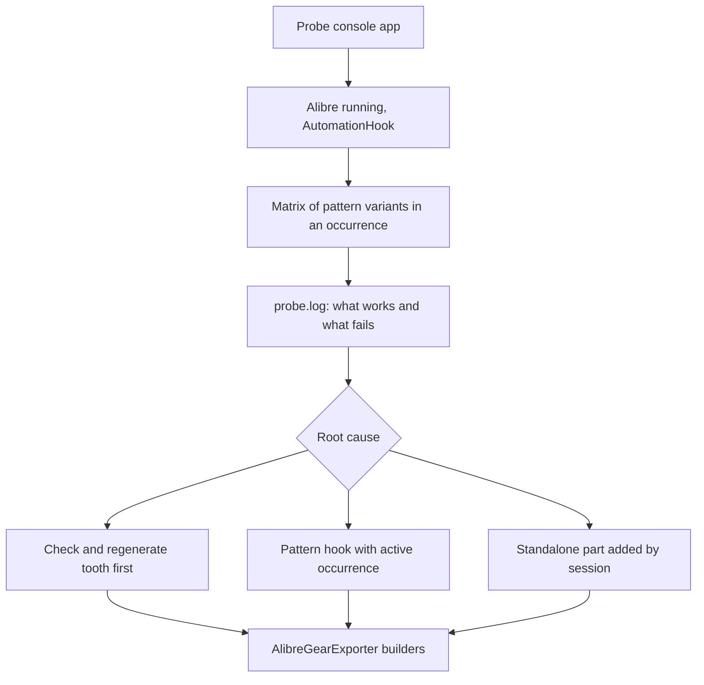
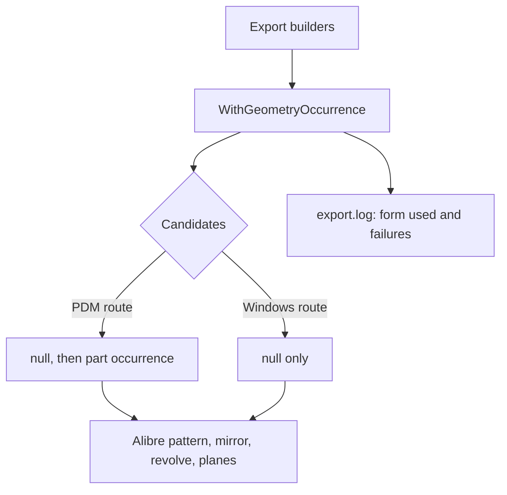
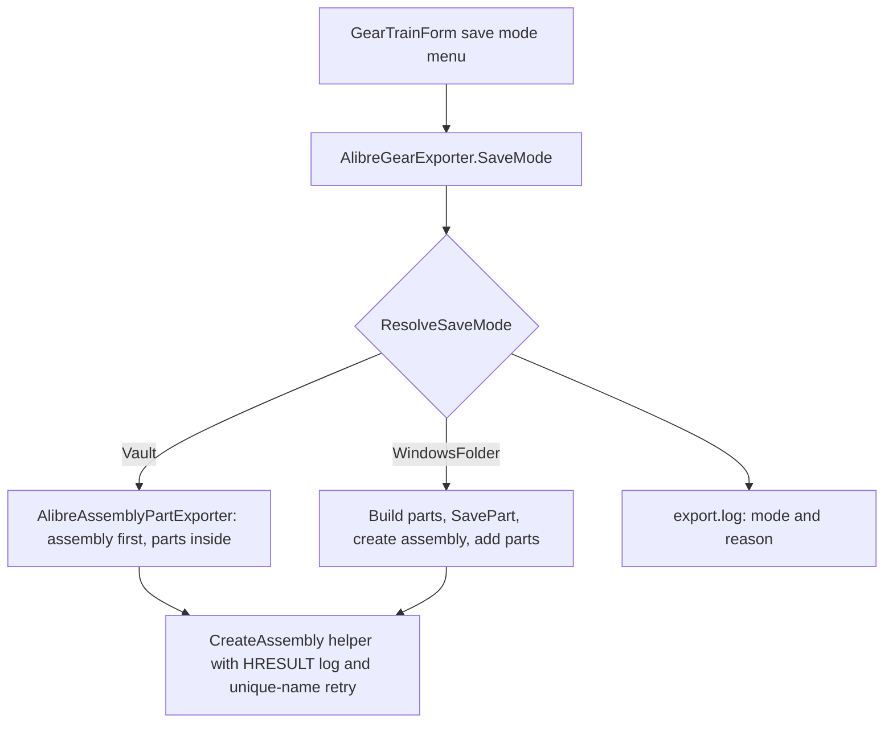
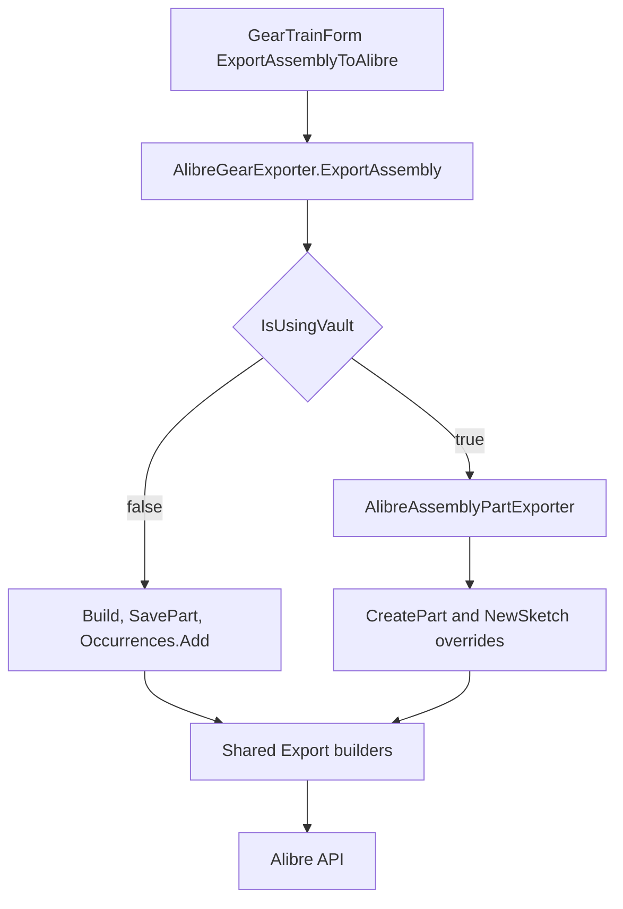

# Requirements

### Follow-up 4: README run command fails with "The module 'Tools' could not be loaded" (part of step 9 handoff)
Following `Tools\AlibrePatternProbe\README.md`, the user's PowerShell prints `& : The module 'Tools' could not be loaded. For more information, run 'Import-Module Tools'.` No Alibre call has run yet; the failure is in how the README starts the probe.

Findings:
- Step 5 of the README runs `$probe = 'Tools\AlibrePatternProbe\bin\Debug\net481\AlibrePatternProbe.exe'` and invokes it with `& $probe ...` using a **relative** path. When PowerShell cannot find a file at that path, it reads `Tools\AlibrePatternProbe...` as a module-qualified command name (`Module\Command`), so it tries to load a module called `Tools`. That is exactly the reported message.
- So the exe is not at that path relative to the current directory. Two likely reasons: the probe was not built (README step 2 skipped or failed; the earlier review deleted its `bin` and `obj`, so nothing is left from the agent's runs), or the shell is not in `D:\02_Repository\02_Bolsover\28_Gears`. `AlibrePatternProbe.csproj` (net481, no explicit output path) does produce `bin\Debug\net481\AlibrePatternProbe.exe`, so the path itself is right.
- The README gives no check that the build succeeded or that the file exists, so the failure shows up as this misleading module error.

Goals:
- The README commands work from any directory and fail with a clear message (not a module error) when the probe is not built.
- No product code change; the evidence status of step 9 (Windows mode only, PDM run still missing) is unchanged.

Immediate workaround for the user (also goes into the README):
```powershell
Set-Location 'D:\02_Repository\02_Bolsover\28_Gears'
dotnet build 'Tools\AlibrePatternProbe\AlibrePatternProbe.csproj' -c Debug -nologo -v q
Test-Path '.\Tools\AlibrePatternProbe\bin\Debug\net481\AlibrePatternProbe.exe'   # must print True
```

### Follow-up 3: both occurrence forms of the tooth pattern fail in Alibre (steps 9-11)
With the steps 7-8 build and PDM on, 'Export all' still stops at the tooth pattern, now with `OccurrenceFormsFailedException: Alibre rejected the circular pattern of the tooth with every owner occurrence form tried: none: COMException 0x8000FFFF: Object reference not set to an instance of an object.; part occurrence: COMException 0x8000FFFF: ...` (raised by `AlibrePartFeatures.executeCircularFeaturePattern`, called from `AlibreGearExporter.Export(InvoluteGearComponent, string)` line ~1863 through `WithGeometryOccurrence`, line ~944). The null reference is inside Alibre (Java side), and it is identical for both forms, so the owner occurrence argument is probably not the cause.

The user asks to establish the root cause by running Alibre (`C:\Program Files\Alibre Design 29.1.1.29133\Program\Alibre Design.exe`) before attempting a correction. The plan therefore starts with a diagnostic run and only then changes the exporter.

Findings from the code:
- The involute path (`Export(InvoluteGearComponent, string)`) never checks the tooth feature before patterning (the worm, bevel and pulley paths call `CheckFeature`). If `AddExtrudedBoss` in the part occurrence returned a null or failed feature, or a feature that is not resolved yet, the pattern would receive an invalid target and Alibre would dereference null.
- The part is built between `StartChanges()` and `StopChanges()` on the occurrence's design session, and `RegenerateAll()` runs only at the end, after the pattern; a feature may not exist for the pattern engine until regenerated.
- The axis is `session.DesignAxes.Item("Z-Axis")` of the occurrence session, and the target collector comes from `_root.NewObjectCollector()`; whether Alibre needs the part occurrence to be the active occurrence (edit in context) or an axis/feature proxy obtained through the occurrence is not documented (`Reference\API Documentation\03_features.md` lists a signature without the occurrence arguments).
- The sample `AssemblyTests` only proves sketch + extrude in an occurrence, nothing about patterns.

Goals:
- Find, by experiment in Alibre 29.1 with Vault/PDM saving on, the exact condition that makes `executeCircularFeaturePattern` fail in an assembly part occurrence, and the smallest change that makes it work.
- Fix the exporter for that cause only: the gear shows all its teeth with PDM on; the other pattern, mirror, revolve and plane calls that share the cause are fixed the same way.
- Keep the Windows folder route and the public `Export(...)` signatures unchanged.
- If no pattern form works in an occurrence, report that clearly and use the best alternative found by the probe (see Technical Design) instead of guessing.

### Follow-up 2: PDM export fails while patterning the tooth (steps 7-8)
With PDM on, the in-assembly route now creates the assembly and the part occurrence, and draws and extrudes the tooth, but then fails with `Alibre export of gear 'Gear 1' failed while patterning the tooth: Object reference not set to an instance of an object` (a `COMException` raised in `AlibrePartFeatures.executeCircularFeaturePattern`, from `AlibreGearExporter.Export(InvoluteGearComponent, string)` line ~1749 via `AlibreAssemblyPartExporter.BuildInPlace`).

Findings:
- The tooth sketch (`NewSketch` with the part occurrence) and the extrusion (`AddExtrudedBoss`, occurrence arguments `null`) succeed. The first call that receives the part occurrence as `pAxisGeneratorOcc` is the circular pattern: `AlibreAssemblyPartExporter.GeometryOccurrence` returns `_currentOccurrence`, and the axis comes from `session.DesignAxes.Item("Z-Axis")` of the part's own design session. A null reference inside Alibre points at that occurrence/axis pairing (an axis of the part being edited is not owned by a separate occurrence), not at the gear data.
- The same `GeometryOccurrence` argument is used by every other construction call of the in-assembly route: circular patterns (involute, worm, bevel, curved bevel, pulley), the rack linear pattern, mirrors, `AddRevolvedBoss`, `CreateBy2Planes`, `CreateAtOffsetToPlane`, `CreateAtAngleToPlane`, `CreateBy3Points`, `AddHerringboneMirror`. They will fail the same way once reached.
- The local API reference (`Reference\API Documentation\03_features.md`) lists no occurrence argument for the circular pattern, so what the occurrence must be cannot be read from it; the agent cannot run Alibre.

Goals:
- The in-assembly route builds the full gear (teeth patterned) and every other component type.
- Because the right occurrence argument cannot be proven offline, each such call tries the form without an owner occurrence first (as the working extrusion does), then with the part occurrence, and the log records which form each call used and what failed.
- A failure reports both attempts (message and HRESULT) instead of a bare null reference.
- The Windows folder route is unchanged (it has one candidate, `null`).
- Minimal change; no change to the public `Export(...)` signatures, the UI or the save mode logic.

### Follow-up: Export all still fails with PDM (steps 4-6)
With the latest build and Alibre set to save to PDM, 'Export all to Alibre' still stops with 'failed while creating the assembly'. The required strategy is unchanged and is already coded: PDM -> create the assembly first, then create each part inside it (`AlibreAssemblyPartExporter.ExportAssemblyInPlace`); Windows -> build and save each part to a Windows folder, then create the assembly and add the parts (`AlibreGearExporter.ExportAssembly` folder flow); a single part -> `Export(...)` only, no assembly. What is missing is a way to see and control which strategy ran, and a diagnosis of the assembly-creation failure.

Findings from the code and the API reference:
- The in-place route calls `Root.CreateEmptyAssemblyEx(name, true)`, identical to `AssemblyTestsAddOn.CreateAssemblyWithPart` (line 98), so the call itself is not the difference.
- The stage text 'creating the assembly' is the same in both routes (the folder route sets it after all parts were built and `SavePart` swallowed any rejected save), so the message cannot tell which route ran.
- `AlibreGearExporter.IsUsingVault()` returns false when `_root.VaultInfo.IsUsingVault` throws, so an unreadable option silently selects the Windows route, and the log never states the chosen mode.
- The failing assembly step reports only `ex.Message`; the Alibre error code (HRESULT) and exception type are lost.

Goals of the follow-up:
- A visible, logged save mode: Auto (read `IsUsingVault`), Windows folder, or PDM, with a manual override in the UI (chosen by the user).
- The detected mode and the reason are written to `export.log` and named in the error message.
- The assembly-creation step reports the full Alibre error and retries once with a unique assembly name (a name already used in the Vault is a likely PDM-only rejection).
- Single-part export is confirmed to create no assembly (test).

### Overview & Goals (original task, delivered in steps 1-3)
'Export all to Alibre' (and 'Export selected' with the Assembly choice) currently fails when Alibre's system option is set to save to the Vault (PDM). `AlibreGearExporter.ExportAssembly` (Gears\Calculator\Alibre\AlibreGearExporter.cs, ~line 898) detects this with `IsUsingVault()` and throws, because it builds each part standalone, saves it to a Windows folder with `SaveNew`, and only then adds it to the assembly with `IADOccurrences.Add`.

Goal: when PDM is on, create the assembly first and create each part directly inside it, as shown in `D:\02_Repository\02_Bolsover\AssemblyTests\AssemblyTestsAddOn.cs` (`CreateEmptyAssemblyEx` -> active root occurrence -> `Occurrences.AddEmptyPart` -> build on `partOccurrence.DesignSession`, passing the occurrence to `Sketches.AddSketch`). The behaviour with the Windows file system is unchanged.

### Scope
**In scope**
- New in-assembly assembly export used when `IsUsingVault` is true.
- Sharing the existing part builders between the two paths through a base class with overridable hooks.
- Unit tests for the non-Alibre logic, documentation update.

**Out of scope**
- Single part export and 'separate parts' export (unchanged).
- Changing the Alibre system option (the API cannot).
- Saving or checking in to the Vault.

### User Stories
- As a user with Alibre set to save to PDM, I want 'Export all to Alibre' to produce a complete assembly so that I can work on my gear train without changing Alibre options.
- As a user saving to the Windows file system, I want the export to behave exactly as today.

### Functional Requirements
- Vault off: current flow (build part, `SavePart`, create assembly, `AddPart`) is retained unchanged.
- Vault on: assembly is created first; every gear, shaft, carrier and belt is created as an empty part occurrence at its placement (`ToAlibreMatrix` of the same `GetPartPlacement` / `GetShaftPlacement` / `GetBeltPlacement` transforms) and built with the same geometry as today.
- Selection (`IReadOnlyCollection<object>`), minimum part count, naming, the export log and the exception style (`Alibre export ... failed while {stage}`) stay the same.
- The UI (`GearTrainForm.ExportAssemblyToAlibre`, line ~745) keeps calling `ExportAssembly`; its message 'each as a new part' stays valid.

### Non-Functional Requirements
- Minimal change to the proven file system path; no change to public `Export(...)` signatures.
- Keep model/geometry logic separate from the UI, follow the C# naming rules in the project guidelines.

# Technical Design

### Follow-up 4 design (README fix)
**Change only `Tools\AlibrePatternProbe\README.md`** (and the usage comment in `Program.cs` only if it mentions paths; it does not need to change).
- Add a first step: `Set-Location 'D:\02_Repository\02_Bolsover\28_Gears'` and `$repo = (Get-Location).Path`, then build both projects with an exit-code check (`if ($LASTEXITCODE -ne 0) { throw 'build failed' }`) so a failed build is reported at that step.
- Replace the relative `$probe` by an absolute path: `$probe = Join-Path $repo 'Tools\AlibrePatternProbe\bin\Debug\net481\AlibrePatternProbe.exe'`, add `if (-not (Test-Path -LiteralPath $probe)) { throw "Probe not built: $probe (run steps 1-2 from $repo)" }` before the loop, and invoke it as `& $probe ...` (absolute, so PowerShell never treats `Tools\` as a module). Build the log paths from `$repo` too, instead of the hard-coded absolute string.
- Add a short troubleshooting note: the message `The module 'Tools' could not be loaded` means the exe path does not exist relative to the current directory (not built, or wrong directory); fix with the `Set-Location` + build + `Test-Path` lines.
- Keep all evidence caveats, the extents note, the cleanup section and the `.gitignore` as they are.

**Risks**
- The agent cannot see which of the two causes applies on the user's machine; the guarded script covers both and prints the exact missing path.
- The commands are verified by running the build commands and the `Test-Path` guard in PowerShell; the probe itself is not run because Alibre may hold the user's documents and PDM is still off in the last check.

### Follow-up 3 design (steps 9-11)
**Approach: probe first, fix second.** The failing call is inside Alibre and cannot be reasoned out from the code, so a throw-away probe program runs the experiment in the real application. Alibre exposes its `AutomationHook` through the running object table (`Marshal.GetActiveObject("AlibreX.AutomationHook")`, `Reference\API Documentation\00_concepts.md` line ~1237), so an external console program can drive an Alibre instance that is already running with the user's PDM setting; no add-on installation or UI clicking is needed. The agent starts `Alibre Design.exe` (path above) in the background, waits for the automation hook, and runs the probe. Where the PDM option is not active in the instance (it cannot be set through the API), the probe records `IADVaultInfo.IsUsingVault` in its output and the user is asked to switch the option and rerun.

**Probe (`Tools\AlibrePatternProbe`, not part of the product or the solution build)**
One console project referencing `AlibreX` and the `Gears` project. It builds a minimal tooth (a closed sketch of a rectangle or one `SingleToothSketchBuilder` tooth, extruded) and then tries the circular pattern as a matrix of variants, writing one line per variant (variant, result, exception type, HRESULT, `HasError`, feature count after) to `probe.log`, and deleting what it made between variants:
1. **Control** in a standalone part from `CreateEmptyPartEx` with the same arguments as `Export(InvoluteGearComponent, string)`: proves the arguments are valid when no assembly is involved.
2. **Baseline in an occurrence** exactly as `AlibreAssemblyPartExporter` builds today (sketch with the occurrence, extrude, pattern with owner `null` and with the part occurrence).
3. **Tooth validity:** log whether the extruded tooth is null and its `HasError`, and whether `targets.Count` is 1.
4. **Regenerate first:** `session.RegenerateAll()` (or `StopChanges()` then `StartChanges()` again, then re-read the feature and axis from `occurrence.DesignSession`) before the pattern.
5. **Edit in context:** `assembly.ActiveOccurrence = partOccurrence` while patterning, then back to the root.
6. **Owner and axis forms:** owner = root occurrence; axis from `occurrence.DesignSession.DesignAxes`; axis given by name; linear edge instead of a design axis; `patternGeometry` true and false; instance count and angle as `int`/`double`/string.
7. **Alternative strategy B:** build the part standalone (`CreateEmptyPartEx`, unsaved) and add it with `Occurrences.Add(ref session, transform)`; record whether PDM accepts an unsaved part by session.
8. The same matrix once with Windows-folder saving, to show whether the failure is PDM-specific.
The probe then runs the real `AlibreAssemblyPartExporter.ExportAssemblyInPlace` for a two-gear train built with the same fixture as the unit tests, to confirm the end-to-end result after the fix.

**Fix (shape decided by the probe result; the expected outcomes and the change each implies)**
- *Tooth not valid or not regenerated yet:* add `CheckFeature(tooth, ...)` and a regeneration hook before the pattern in `Export(InvoluteGearComponent, string)` (and the worm, bevel, pulley builders); in `AlibreAssemblyPartExporter` implement it by regenerating the occurrence session.
- *Pattern needs the occurrence to be active (edit in context) or re-read proxies:* make the pattern call go through a new `protected virtual` hook in `AlibreGearExporter` (for example `AddCircularPattern(session, targets, count, angle, axis, name)`) whose base implementation is today's single call (Windows route unchanged); `AlibreAssemblyPartExporter` overrides it to set `ActiveOccurrence` / refresh the axis and feature, call, and restore the root occurrence in `finally`.
- *Pattern is impossible in an occurrence:* use alternative B for components that need a pattern (`CreatePart` creates the part standalone and the exporter adds it by session) or replace the pattern by a different supported feature (for example the same pattern in a standalone part before it is added); decided from probe item 7.
The `WithGeometryOccurrence` helper stays for the calls where the probe shows the occurrence form matters, and is simplified for the calls where it does not (the diagnostic overhead is removed only when the evidence says so). `OccurrenceFormsFailedException` and the stage-aware catch filters stay.



**Files**
- Added: `Tools\AlibrePatternProbe\AlibrePatternProbe.csproj`, `Program.cs` (diagnostic only; kept in `Tools`, outside `Gears.sln`).
- Modified (after the probe): `Gears\Calculator\Alibre\AlibreGearExporter.cs`, `Gears\Calculator\Alibre\AlibreAssemblyPartExporter.cs`, `UnitTests\TestAlibreGeometryOccurrence.cs`, `Writerside\topics\gear-assemblies.md`.

**Risks**
- Alibre must be running with PDM saving on for the probe to be conclusive; the probe records `IsUsingVault` and the plan does not claim a result without it. If Alibre cannot be started or attached from the agent session, the probe is handed to the user as a ready-to-run program and the fix stage waits for its `probe.log`.
- A failed probe variant can leave stray features, parts or assemblies in the Alibre session; each variant works in a fresh assembly that is closed without saving, and the probe never writes to the Vault.
- A probe that opens a licence dialog or Vault login can block; the run uses a time limit and reports a timeout instead of hanging.
- Only evidence from the probe changes the product code; no speculative fix is applied.

### Follow-up 2 design (steps 7-8)
**Current code**
- `AlibreGearExporter.GeometryOccurrence` (`protected virtual IADOccurrence`, null in the base class) is passed as the occurrence argument of ~15 Alibre calls; `AlibreAssemblyPartExporter` overrides it with `_currentOccurrence` (reset to null after each part in `BuildInPlace`).
- Pattern calls (lines ~273, 419, 527, 1620, 1749) pass it with `axis`/`gearAxis` obtained from `session.DesignAxes.Item(...)`. The involute and pulley pattern results are not checked.

**Key decisions**
1. **Candidate occurrences, not a guess.** Replace the single `GeometryOccurrence` property by a candidate list for the occurrence argument: the base class returns `[null]`; `AlibreAssemblyPartExporter` returns `[null, _currentOccurrence]` (null first because the axis and planes are owned by the part's own design session and the working extrude passes null). Rationale: the correct argument cannot be verified without Alibre; trying both removes the guess and the log shows the answer.
2. **One helper for all occurrence-taking calls.** `protected T WithGeometryOccurrence<T>(string what, Func<IADOccurrence, T> call)` runs `call` for each candidate in order; a form that throws, or returns a null feature / one with `HasError` (deleted quietly), is recorded and the next form is tried. The first form that works is remembered for the rest of the part (`_workingForm`), so later calls try it first. If all fail it throws an `InvalidOperationException` that lists every attempt (form, type, HRESULT, message) and keeps the first exception as inner exception. With one candidate (base class) the call is made once and its exception propagates unchanged, so the Windows route behaves as today.
3. **Log which form worked.** The helper writes `geometry occurrence for <what>: none|part occurrence` into a protected log hook (`AddDiagnostic(string)`), which `AlibreAssemblyPartExporter` copies into the `export.log` lines, so the next real-Alibre run answers the question even if another call fails later.
4. **Do not change the builders' structure.** Only the call sites that currently pass `GeometryOccurrence` are wrapped: `AddCircularFeaturePattern` (5), `AddLinearFeaturePattern` (rack), `AddMirrorFeaturePattern`, `AddRevolvedBoss` (bevel, curved bevel, flange), `CreateBy2Planes`, `CreateAtOffsetToPlane`, `CreateAtAngleToPlane`, `CreateBy3Points`. Sketches keep `NewSketch` with the part occurrence (proven by the sample).



**Files**
- Modified: `Gears\Calculator\Alibre\AlibreGearExporter.cs` (candidate list, `WithGeometryOccurrence`, call sites), `Gears\Calculator\Alibre\AlibreAssemblyPartExporter.cs` (candidates, diagnostics into the log), `UnitTests\TestAlibreAssemblyExport.cs`, `Writerside\topics\gear-assemblies.md`.

**Risks**
- If Alibre rejects both forms for the pattern, the message now carries both errors and the next step is data-driven (e.g. patterning with `patternGeometry` toggled, or `RegenerateAll` before the pattern); the plan does not claim the fix works in Alibre.
- A failed attempt can leave a half-made feature; the helper deletes a returned feature that has an error and never touches the sketch or the tooth.
- Passing the part occurrence for a later call but null for an earlier one is harmless in Alibre terms; the helper remembers the working form per part only, so each part is re-probed.
- Only one part is built at a time; `_currentOccurrence` must still be reset in `BuildInPlace`'s `finally`.

### Follow-up design (steps 4-6)
**Key decisions**
1. **Explicit save mode on the exporter.** New `public enum AlibreSaveMode { Auto, WindowsFolder, Vault }` and `AlibreGearExporter.SaveMode` (default `Auto`); `ExportAssembly` resolves it once via a private `ResolveSaveMode(List<string> log)`. Auto uses `IsUsingVault`; a read error is logged and treated as Windows (as today) rather than hidden. Vault and WindowsFolder skip detection.
2. **Same dispatch, now logged.** `ExportAssembly` keeps `Vault -> ExportInAssembly`, `WindowsFolder -> folder flow`; the chosen mode and its source ('detected', 'forced') become the first log line and part of the failure message. `CopyOptionsTo` also copies `SaveMode`.
3. **Hardened assembly creation in `AlibreAssemblyPartExporter`.** Split the stage into 'creating the assembly', 'opening the root occurrence' and 'reading the geometry factory'; on a failure of `CreateEmptyAssemblyEx` log type, `COMException.ErrorCode` (hex) and message, then retry once with a unique name (`DefaultAssemblyName` + time stamp) and log both attempts; if the retry fails, throw the first error with the second attached. The folder flow's own `CreateEmptyAssemblyEx` call gets the same helper so both routes behave alike.
4. **UI override, session-only.** A radio-style submenu 'Alibre save mode' (Auto, Windows folder, PDM) next to the two export items in `GearTrainForm`, setting `_alibreExporter.SaveMode`; the success and failure messages in `ExportAssemblyToAlibre` name the mode used. No persistence (minimal change).



**Files**
- Added: `Gears\Calculator\Alibre\AlibreSaveMode.cs`.
- Modified: `Gears\Calculator\Alibre\AlibreGearExporter.cs` (SaveMode, ResolveSaveMode, assembly-creation helper, log line, `CopyOptionsTo`), `Gears\Calculator\Alibre\AlibreAssemblyPartExporter.cs` (stages, helper use), `GearsUI\Gui\Views\GearTrainForm.cs` (submenu, messages), `UnitTests\TestAlibreAssemblyExport.cs`, `Writerside\topics\gear-assemblies.md`.

**Risks**
- The root cause inside Alibre cannot be reproduced by the agent; steps 4-5 make the next failure self-explanatory (mode, HRESULT, both attempts in `export.log`) and cover the two most likely causes (wrong mode, name rejected).
- A forced PDM mode on a file-system setup, or the reverse, fails inside Alibre; the message states the forced mode.
- The retry creates a second assembly document if the first call half-succeeded; the log records it and the failed document is not touched.

### Current Implementation (as of the original task)
- `AlibreGearExporter` (sealed, ~1700 lines) has one `Export(...)` overload per component type (involute, rack, worm, worm wheel, bevel, curved bevel, HTD pulley, cycloidal, shaft/carrier, belt). All of them call the private `CreatePart(name)` (`_root.CreateEmptyPartEx`) and then `session.Sketches.AddSketch(null, plane, name)` (about 14 call sites), `session.DesignPlanes/DesignAxes/DesignPoints/Features`, and finally `RegenerateAll()`.
- `ExportAssembly` builds + saves all parts, then `CreateEmptyAssemblyEx`, sets `ActiveOccurrence = RootOccurrence`, adds the parts via `AddPart` (path or session) with `ToAlibreMatrix` transforms, and calls `RegenerateDesign`. `IsUsingVault()` blocks the PDM case.
- Placement and part-list helpers (`GetAssemblyParts`, `GetShaftAssemblyParts`, `GetBeltAssemblyParts`, `GetPartPlacement`, `GetShaftPlacement`, `GetBeltPlacement`, `ToAlibreMatrix`, `UniqueName`) are static and need no Alibre.
- Reference sample: `AssemblyTestsAddOn.CreateAssemblyWithPart` (AddEmptyPart requires the parent occurrence to be the active occurrence; `StartChanges`/`StopChanges` around the build; sketch created with the part occurrence; `AddExtrudedBoss` is called on the session cast to `IADPartSession`; depth must be a double).
- UI: `GearTrainForm.ExportAllToAlibre` -> `ExportAssemblyToAlibre` -> `_alibreExporter.ExportAssembly`. Existing tests: `UnitTests\TestAlibreAssemblyExport.cs` (pure helpers only).

### Key Decisions
1. **Separate in-assembly exporter, builders shared through a base class.** `AlibreGearExporter` is unsealed and gets two protected virtual hooks; a new subclass overrides them. Rationale: one copy of the geometry code, no duplication, existing path untouched.
2. **Vault on -> in-assembly exporter; vault off -> existing folder flow.** Chosen to retain the Windows file system behaviour as the task requires. `ExportAssembly` dispatches on `IsUsingVault()` instead of throwing.
3. **Hooks, not new parameters.** `Export(...)` overloads keep their signatures and the UI is unchanged.

### Proposed Changes
- `AlibreGearExporter`: remove `sealed`; make `CreatePart(string name)` `protected virtual`; add `protected virtual IADSketch NewSketch(IADPartSession session, IADDesignPlane plane, string name)` that returns `session.Sketches.AddSketch(null, plane, name)`; replace the ~14 `AddSketch(null, ...)` calls with `NewSketch(session, ...)`. In `ExportAssembly`, replace the vault exception with a call to the in-assembly exporter (created from `_root`, copying `PatternGeometry`, `CurvedBevelSectionCount`, `AxialPlaneSketchYIsNegativeZ`, `AssemblyFolder`), and make `IsUsingVault` accessible to it. Extract the shared pre-checks (`GetAssemblyParts`, `CheckPartCount`) so both paths use them.
- New `AlibreAssemblyPartExporter : AlibreGearExporter`: `ExportAssemblyInPlace(train, name, selection)` creates the assembly, activates the root occurrence, then for each part sets the pending transform and calls `ExportComponent` / `Export(Shaft)` / `Export(TimingBelt, phase)`.
  - Overridden `CreatePart(name)`: `rootOccurrence.Occurrences.AddEmptyPart(name, false, transform)`, remembers the occurrence, `StartChanges()` on its `DesignSession`, returns the session as `IADPartSession`.
  - Overridden `NewSketch(...)`: `session.Sketches.AddSketch(_currentOccurrence, plane, name)`.
  - After each part (in `finally`): `StopChanges()`, reset the active occurrence to the root. At the end `RegenerateDesign(true)`; same log file and error wrapping as today.
- Investigation items to verify in Alibre (cannot be run by the agent): `RegenerateAll()` on an occurrence session, `DesignPoints.CreatePoint`/plane/axis creation used by the bevel builders, `AddCircularFeaturePattern` and the rack linear pattern on an occurrence session, and whether `_root.NewObjectCollector()` features accept occurrence geometry. Where a call needs the occurrence, add a further protected hook rather than changing the builders.

### Data Models / Contracts
```csharp
// AlibreGearExporter (changed)
protected virtual IADPartSession CreatePart(string name);
protected virtual IADSketch NewSketch(IADPartSession session, IADDesignPlane plane, string name);

// AlibreAssemblyPartExporter (new)
public IADAssemblySession ExportAssemblyInPlace(GearAssembly train, string assemblyName, IReadOnlyCollection<object> selection);
```

### File Structure
- Modified: `Gears\Calculator\Alibre\AlibreGearExporter.cs`
- Added: `Gears\Calculator\Alibre\AlibreAssemblyPartExporter.cs`
- Modified: `UnitTests\TestAlibreAssemblyExport.cs` (or a new `TestAlibreAssemblyPartExporter.cs`)
- Modified: Writerside topic on Alibre export (user-facing PDM behaviour)

### Architecture Diagram


### Risks
- The in-assembly API behaviour for pattern, plane, axis and point features is only proven by the sample for sketch + extrude; mitigated by the hook design (extra hooks can be added) and by a clear stage-tagged error message and log.
- Unsealing the class exposes it to subclassing; hooks are `protected` and documented.
- Only one part session can be in a change block at a time; `StopChanges` is always done in `finally`.
- `ActiveOccurrence` must be the root before every `AddEmptyPart`.

# Testing

### Follow-up 4 tests (README fix)
- From a different working directory, run the README's new setup lines and build commands; the probe exe exists afterwards and `Test-Path` is True.
- Run the README's invocation block with the exe missing (before the build) and confirm it stops with the 'Probe not built' message and not the module error. Then run it with an invalid mode argument only if Alibre is not running; otherwise do not start the probe (it attaches to the user's Alibre).
- Delete the probe's `bin` and `obj` afterwards, as the README says.

### Follow-up 3 tests (steps 9-11)
- The probe run itself is the root-cause evidence: `probe.log` is kept with the results of every variant for both saving modes, and the stage reports which variant is the first that works.
- After the fix: run the probe's end-to-end export (`AlibreAssemblyPartExporter.ExportAssemblyInPlace` for a two-gear train) with PDM on and check in Alibre through the API that each gear part occurrence has its tooth pattern (feature count and pattern feature without `HasError`), and that the assembly has the expected number of occurrences.
- Regression unit tests in `UnitTests\TestAlibreGeometryOccurrence.cs` with the existing `DeepStub` / `PatternFailureExporter` stand-ins: the involute path checks the tooth feature (null and `HasError` give a clear stage message); the new pattern hook is called once on the Windows route with unchanged exception wrapping; the PDM exporter's override performs its preparation steps in order and always restores the root occurrence, also when the pattern throws.
- The full UnitTests suite and the solution build stay green.
- Manual (user, in Alibre): only what the probe cannot show, such as the visual check of the teeth and the helical, bevel, rack and pulley parts under PDM.

### Follow-up 2 tests (steps 7-8)
The Alibre calls cannot be run by the agent; the new logic is tested through the helper with delegates and the existing `IADRoot` stand-in in `UnitTests\TestAlibreAssemblyExport.cs`:
- First form throws a `NullReferenceException`-style `COMException`, second succeeds: the helper returns the second result and the first call is not repeated for later calls of the same part.
- Both forms fail: the thrown `InvalidOperationException` names both forms, both HRESULTs and messages, with the first exception as inner exception.
- A form that returns a feature with `HasError` is deleted and the next form is tried.
- One candidate (base exporter): exactly one call and the original exception type propagates (Windows route unchanged).
- The PDM exporter's candidate list is `[null, part occurrence]` and `[null]` outside a part build.
- The full UnitTests suite and the solution build stay green.
- Manual (user, in Alibre): PDM on, Export all with a spur gear pair; check the gear shows all teeth and read `export.log` for the 'geometry occurrence' lines; repeat once with a helical gear, a bevel gear and a rack if used.

### Follow-up tests (steps 4-6)
Using the existing `VaultRoot` / `RealProxy` `IADRoot` stand-in in `UnitTests\TestAlibreAssemblyExport.cs`:
- `SaveMode.Vault` first calls `CreateEmptyAssemblyEx`, `SaveMode.WindowsFolder` first calls `CreateEmptyPartEx`, each regardless of what `IsUsingVault` answers (including an unreadable `VaultInfo`).
- `Auto` with a throwing `VaultInfo` logs the read failure and the mode in `export.log` and in the message.
- A throwing `CreateEmptyAssemblyEx` is called twice (second name differs), and the message contains the exception type and the hex error code of a `COMException`.
- A single-part `Export(...)` never calls `CreateEmptyAssemblyEx`.
- `CopyOptionsTo` copies `SaveMode`.
- Manual (user, in Alibre): PDM on with Auto and with PDM forced; Windows with Auto; read `export.log` first line for the mode.

### Validation Approach
The agent can build the solution and run unit tests; Alibre itself cannot be driven, so Alibre calls need a manual check by the user.

### Key Scenarios
- Solution builds with the refactored hooks (no behaviour change in `AlibreGearExporter`).
- Existing `TestAlibreAssemblyExport` tests still pass.
- Manual (user, in Alibre): Vault off -> same result as today; Vault on -> 'Export all' creates an assembly with all gears, shafts, carriers and belts at the correct placement.

### Edge Cases
- Fewer than 2 parts still gives the minimum-count error before any Alibre call.
- A failing part reports the stage and writes the log, and `StopChanges` is still called.
- Selection exports only the selected items on the PDM path.

### Test Changes
- Add tests for the Alibre-free logic shared by both paths (part lists, count check, vault dispatch helper if made testable).
- No automated test for the Alibre calls themselves (stated in the existing test file header).

# Delivery Steps

### ✓ Step 1: Refactor AlibreGearExporter to expose sketch and part creation hooks
AlibreGearExporter can be subclassed and all builders create parts and sketches through two overridable hooks, with unchanged behaviour on the Windows file system.

- Remove `sealed` from `AlibreGearExporter` in `Gears\Calculator\Alibre\AlibreGearExporter.cs`.
- Make `CreatePart(string)` `protected virtual`.
- Add `protected virtual IADSketch NewSketch(IADPartSession session, IADDesignPlane plane, string name)` returning `session.Sketches.AddSketch(null, plane, name)`.
- Replace every `session.Sketches.AddSketch(null, ...)` call (rack, worm, bevel, curved bevel, pulley, belt, shaft, involute, cycloidal) with `NewSketch(session, ...)`.
- Share the `GetAssemblyParts` / `GetShaftAssemblyParts` / `GetBeltAssemblyParts` / `CheckPartCount` pre-checks so both export paths use them.
- Build the solution and run `UnitTests` to confirm there is no regression.

### ✓ Step 2: Add AlibreAssemblyPartExporter that builds parts inside the assembly
A new exporter creates the assembly first and builds every gear, shaft, carrier and belt directly in it, following the AssemblyTests sample.

- Create `Gears\Calculator\Alibre\AlibreAssemblyPartExporter.cs` deriving from `AlibreGearExporter`.
- Implement `ExportAssemblyInPlace(train, assemblyName, selection)`: `CreateEmptyAssemblyEx`, set `ActiveOccurrence` to the root occurrence, then iterate gears, shafts/carriers and belts using the existing placement helpers and `ToAlibreMatrix`.
- Override `CreatePart` to call `Occurrences.AddEmptyPart(name, false, transform)`, keep the part occurrence, and call `StartChanges()` on its `DesignSession`.
- Override `NewSketch` to call `AddSketch(partOccurrence, plane, name)`.
- Call `StopChanges()` in `finally` after each part and restore the root occurrence; finish with `RegenerateDesign(true)`, the export log and the stage-tagged error wrapping used by `ExportAssembly`.
- Add further protected hooks if a builder call (design points, planes, axes, patterns, `RegenerateAll`) needs the occurrence.

### ✓ Step 3: Dispatch on the Vault option, add tests and update docs
'Export all to Alibre' works with PDM on and is unchanged with the Windows file system, with tests and documentation updated.

- In `AlibreGearExporter.ExportAssembly`, replace the `IsUsingVault()` exception with a call to `AlibreAssemblyPartExporter.ExportAssemblyInPlace`, copying `PatternGeometry`, `CurvedBevelSectionCount`, `AxialPlaneSketchYIsNegativeZ` and the last log path.
- Keep the folder path (`SavePart`, `AddPart`) for the file system case.
- Check that `GearTrainForm.ExportAssemblyToAlibre` messages still make sense for both modes (no functional UI change expected).
- Add unit tests in `UnitTests` for the Alibre-free logic shared by both paths, and keep `TestAlibreAssemblyExport` green.
- Update the Writerside Alibre export topic to describe the PDM behaviour.
- Build the solution and run all tests; list the manual Alibre checks for the user.

### ✓ Step 4: Add an explicit, logged save mode to the exporter
The exporter has a `SaveMode` (Auto, WindowsFolder, Vault) whose decision and reason appear in `export.log` and in the failure message.

- Add `Gears\Calculator\Alibre\AlibreSaveMode.cs` (`Auto`, `WindowsFolder`, `Vault`) and `SaveMode` (default `Auto`) on `AlibreGearExporter`.
- Add `ResolveSaveMode(List<string> log)`: Auto reads `_root.VaultInfo.IsUsingVault` and logs the value or the read failure (treated as Windows); the other values skip detection.
- Use it in `ExportAssembly` in place of the direct `IsUsingVault()` check; write the first log line 'save mode: ... (detected|forced)'; include the mode in the failure message in both routes.
- Make `ExportInAssembly` and `CopyOptionsTo` carry `SaveMode` and the mode log line to `AlibreAssemblyPartExporter`; keep `AlibreAssemblyPartExporter.ExportAssembly` always in place.
- Add unit tests for forced Vault, forced WindowsFolder, Auto with unreadable `VaultInfo` and `CopyOptionsTo`; keep the existing dispatch tests green.

### ✓ Step 5: Harden and diagnose assembly creation under PDM
A failing assembly creation reports the full Alibre error, and is retried once under a unique name.

- Add a protected helper in `AlibreGearExporter` that calls `CreateEmptyAssemblyEx(name, true)`, logs exception type and `COMException.ErrorCode` (hex) on failure, retries once with `DefaultAssemblyName` plus a time stamp, and throws the first error (second attached) if both fail.
- Use it from `AlibreAssemblyPartExporter.ExportAssemblyInPlace` and from the folder flow of `ExportAssembly`.
- In `ExportAssemblyInPlace` separate the stages 'creating the assembly', 'opening the root occurrence' and 'reading the geometry factory'.
- Add unit tests with the `IADRoot` stand-in: two creation attempts with different names, error code in message and log, no retry when the first call succeeds in building the stand-in path; confirm a single-part `Export(...)` never calls `CreateEmptyAssemblyEx`.

### ✓ Step 6: Add the save mode override to the UI and update docs
The user can pick Auto, Windows folder or PDM from the editor and sees which mode an export used.

- In `GearsUI\Gui\Views\GearTrainForm.cs` add an 'Alibre save mode' submenu with three checkable items (Auto selected), enabled with the other Alibre items when `AlibreExporter` is set; selecting one sets `_alibreExporter.SaveMode`.
- Name the mode in the success and failure messages of `ExportAssemblyToAlibre`, and point to `LastExportLog`.
- Update `Writerside\topics\gear-assemblies.md`: the two strategies, the override, where to find the mode in `export.log`, and that a single part creates no assembly.
- Build the solution and run all UnitTests; list the manual Alibre checks (PDM Auto, PDM forced, Windows Auto) for the user.

### ✓ Step 7: Add the geometry occurrence candidates and helper, and use them for the tooth pattern
The PDM route no longer fails with a bare null reference while patterning a gear: the pattern is tried without an owner occurrence first, then with the part occurrence, and the attempts are logged.

- In `Gears\Calculator\Alibre\AlibreGearExporter.cs` add the candidate list for the occurrence argument (base: `[null]`) and `protected T WithGeometryOccurrence<T>(string what, Func<IADOccurrence, T> call)` that tries each candidate, deletes a returned feature with `HasError`, remembers the working form per part, logs it through a protected diagnostics hook, and throws an `InvalidOperationException` listing every attempt (type, hex HRESULT, message) when all fail.
- Wrap the circular pattern calls (involute gear at line ~1749, HTD pulley at ~1620, worm, straight bevel and curved bevel) with the helper; the involute gear and pulley patterns get the same null/`HasError` check as the others, only when more than one candidate exists so the Windows route is unchanged.
- In `AlibreAssemblyPartExporter` return `[null, _currentOccurrence]` while a part is being built, `[null]` otherwise, and copy the diagnostics into the lines written to `export.log`.
- Add the unit tests for the helper and the candidate lists listed under Testing; build and run the full UnitTests suite.

### ✓ Step 8: Apply the helper to the other occurrence-taking calls and update docs
Every construction call of the in-assembly route that takes the part occurrence uses the same two-form retry, so racks, worms, bevels, pulleys with flanges and herringbone gears do not fail at the next call.

- Wrap `AddLinearFeaturePattern` (rack pattern, keeping its existing two-attempt pattern-geometry logic inside each form), `AddMirrorFeaturePattern`, `AddRevolvedBoss`, `CreateBy2Planes`, `CreateAtOffsetToPlane`, `CreateAtAngleToPlane` and `CreateBy3Points` with `WithGeometryOccurrence`.
- Keep the stage text, the exception style and `CheckFeature` behaviour of each builder.
- Update `Writerside\topics\gear-assemblies.md` (PDM section): the two forms are tried, the 'geometry occurrence' lines in `export.log`, and that the in-assembly route is still not verified in real Alibre.
- Build the solution, run all UnitTests, and list the manual Alibre checks (spur pair, helical gear, bevel gear, rack) for the user.

### ! Step 9: Run the pattern probe in Alibre 29.1 and establish the root cause
The cause of the null reference in `executeCircularFeaturePattern` for a part occurrence is identified from a run in Alibre 29.1 with PDM saving on, and recorded in `probe.log`.

- Create `Tools\AlibrePatternProbe` (console project referencing `AlibreX` and the `Gears` project, outside `Gears.sln`) that attaches to the running Alibre through `Marshal.GetActiveObject("AlibreX.AutomationHook")` and writes the output of `IADVaultInfo.IsUsingVault` first.
- Implement the variant matrix described in Technical Design: standalone control, baseline occurrence build, tooth validity check, regenerate first, active occurrence, owner/axis/argument forms, alternative B (standalone part added by session), each in a fresh assembly that is closed unsaved.
- Start `C:\Program Files\Alibre Design 29.1.1.29133\Program\Alibre Design.exe` in the background, wait for the hook with a time limit, run the probe, and repeat once with Windows-folder saving if the user has switched the option (state in the report if only one mode could be run).
- Report which variants fail and which work, name the root cause, and choose the fix shape (check/regenerate, pattern hook with active occurrence, or alternative B). If Alibre cannot be driven from the session, stop here with the ready-to-run probe and its instructions.
- **Follow-up 4 (do this first):** fix `Tools\AlibrePatternProbe\README.md` so the run commands cannot produce "The module 'Tools' could not be loaded": start with `Set-Location` to the repository root, check `$LASTEXITCODE` after each `dotnet build`, define `$probe` as an absolute path with `Join-Path`, guard it with `Test-Path` and a clear error, derive the log paths from `$repo`, and add a troubleshooting note. Verify by running the build commands and the guard from another directory, without starting the probe against the user's Alibre. No product code changes.

###   Step 10: Fix the in-assembly pattern for the proven cause and extend it to the other calls
With PDM on, a gear exported by `AlibreAssemblyPartExporter` has all its teeth, using the form the probe proved.

- Apply the chosen fix in `Gears\Calculator\Alibre\AlibreGearExporter.cs` and `Gears\Calculator\Alibre\AlibreAssemblyPartExporter.cs`: add `CheckFeature` on the tooth of the involute path, and, depending on the probe, a regeneration step, a `protected virtual` pattern hook (base = today's call, so the Windows route is unchanged) overridden to set the active occurrence and restore the root in `finally`, or alternative B in `CreatePart`.
- Use the same fix for the other calls that share the cause (worm, straight and curved bevel and pulley circular patterns, the rack linear pattern, the mirrors), and keep `WithGeometryOccurrence` only where the probe shows the occurrence form matters.
- Keep the stage text, the `OccurrenceFormsFailedException` handling, `export.log` diagnostics and the public `Export(...)` signatures.
- Add the regression tests listed under Testing to `UnitTests\TestAlibreGeometryOccurrence.cs`; build and run the full UnitTests suite.

###   Step 11: Verify the export end to end in Alibre and update docs
The fixed export is confirmed in Alibre 29.1 and the documentation states what was proven.

- Run the probe's end-to-end export (`ExportAssemblyInPlace`, two-gear train) with PDM on, read the gear part occurrences back through the API (pattern feature present and without `HasError`, occurrence count) and attach `export.log`; also run the Windows-folder route once if that mode is available.
- Update `Writerside\topics\gear-assemblies.md` (PDM section): the proven cause, the way the pattern is made in an occurrence, how to read `export.log`, and any remaining limits (helical, bevel, rack, pulley parts that were not run).
- Build the solution and run all UnitTests; list the manual Alibre checks left for the user.