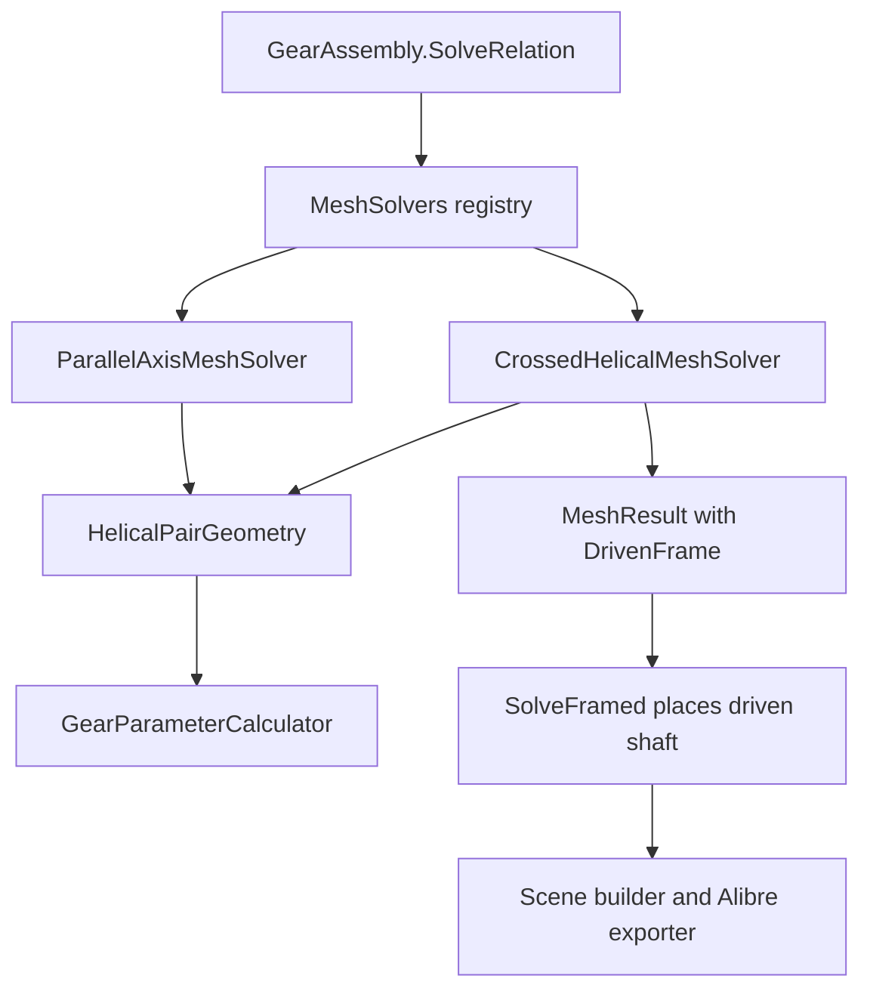

---
sessionId: session-261108-131602-1c7i
---

# Requirements

**Goal / outcome**: Helical gears can mesh on shafts that are not parallel, and the two gears can have different helix angles. The reference case is a 24-tooth 26.6° helical gear driving a 12-tooth 63.4° helical gear on shafts at 90°. Both gears have the same hand and the same normal module. The assembly places the driven shaft at the right angle and distance, the 3D scene and the Alibre export show it, and the speed ratio is 2:1.

**Scope**
- In:
  - A crossed-axis helical mesh: a new `MeshType.CrossedHelical` with its own solver, an optional shaft angle on the relation, and validation of the shaft angle against the helix angles and hands.
  - Per-gear transverse geometry (each gear has its own transverse module and pitch diameter), shared by the parallel and crossed solvers.
  - Saving and loading the shaft angle.
  - Adding the mesh in the gear train editor.
  - Alibre export placement of both gears.
  - Tests, and a `Writerside` note.
- Out:
  - Herringbone, internal and rack helical gears on crossed shafts. Profile-shifted crossed pairs (profile shift stays 0, others are rejected with a message).
  - Bevel, worm and cycloidal meshes.
  - Contact ratio and load calculations for crossed helical gears. They have point contact; the report says so.
  - Planetary sets.
  - `AssemblyInfo.cs`.

**Done when**
- A relation with `MeshType.CrossedHelical` and shaft angle 90° between `InvoluteGearComponent` 24T/26.6° and 12T/63.4° (same hand, same module) solves. The driven shaft axis is 90° to the driver axis, the shafts are `(d1 + d2) / 2` apart, and `GearTrainAnalyzer.SpeedFactor` is 12/24 in magnitude.
- A shaft angle that does not match the helix angles and hands (for example 80° for the pair above) is rejected with a message that gives the expected angle.
- A parallel relation between gears with different helix angles is rejected with a message that points to the crossed mesh. Existing parallel pairs behave as before.
- The saved file keeps the shaft angle. Older files load unchanged.
- `UnitTests` is green with a non-zero executed-test count that includes the new tests.

# Technical Design

**Current implementation (verified in code)**
- `ParallelAxisMeshSolver.Solve` (`Gears\Calculator\Assemblies`) calls `GearParameterCalculator.CalculatePair` and returns a `MeshResult` with no frame, so `GearAssembly.SolveRelation` puts the driven shaft parallel to the driver at the centre distance. It does not check that the helix angles are equal or the hands opposite.
- `CalculatePair` (`Gears\Calculator\GearParameterCalculator.cs:246`) takes the transverse module `mt` and the transverse pressure angle from gear 1 only (`mt = gear1.RadialModule`, `betaRad` from `beta1`). Its centre distance is `mt * sumZ / 2`, and the axial contact ratio uses `beta1`. This is correct only for two gears with the same helix angle. For 26.6° and 63.4° it gives a wrong distance, because the pitch diameters are `z * mn / cos(beta)` for each gear separately.
- Worm and bevel meshes already return `MeshResult.DrivenFrame` (`WormMeshSolver`, `BevelMeshSolver`). `GearAssembly.SolveFramed` places the driven shaft from that frame, after the line-of-centres turn `RotationZ(theta)`, and sets `Shaft.RotationRad`. The scene builder (`GearAssemblySceneBuilder`) and the Alibre exporter (`AlibreGearExporter.GetPartPlacement`) already place parts from `shaft.Placement` and the mount phase, so an angled shaft needs no change there.
- `MeshSolvers` maps each `MeshType` to a solver. `GearTrainAnalyzer.SpeedFactor` and `GearParameterTables` go through the solver and `MeshResult.PairData`, so they work with a new solver without change.
- `IAdjustableCentreSolver` is the existing pattern for a solver that needs one more input than `IMeshSolver.Solve` takes (the centre distance override). `AssemblySerializer` reads `RelationDto.MeshType` with `Enum.TryParse`, plus `CentreLineAngleDeg` and `CentreDistance`.

**Key decisions (confirmed with the user)**
- A new `MeshType.CrossedHelical` with a separate `CrossedHelicalMeshSolver`. The parallel solver keeps its role. Rationale: the worm and bevel pattern already exists, and existing parallel tests stay untouched.
- A shared per-gear pair-geometry helper that both solvers use. `CalculatePair` stops reading gear 1's helix angle for gear 2.
- The shaft angle is entered by the user on the relation and validated against the helix angles and hands. It is not silently derived. The editor pre-fills the derived value for a new crossed mesh.

**Geometry**
- For each gear: transverse module `mt_i = mn / cos(beta_i)`, pitch diameter `d_i = z_i * mt_i`. The gears share the normal module and the normal pressure angle.
- Centre distance `a = (d1 + d2) / 2` (profile shift 0).
- Expected shaft angle: `Sigma = beta1 + beta2` when both have the same hand, `|beta1 - beta2|` when the hands are opposite. For 26.6° and 63.4° with the same hand, `Sigma = 90°`. With `beta1 = beta2` and opposite hands, `Sigma = 0` is the parallel mesh.
- Speed ratio is `z1 / z2` in magnitude, not `d1 / d2`. In the reference case `d1 = d2 = 26.83 * mn` while the speed ratio is 2:1. Nothing may derive the ratio from the diameters.
- Frame of the driven gear in the driver frame (line of centres along +X, as in `BevelMeshSolver`): origin `(a, 0, 0)`, Z axis `(0, -sin Sigma, cos Sigma)`, X axis `(1, 0, 0)`. `SolveFramed` then applies `RotationZ(theta)`, so the in-plane branching with `CentreLineAngleDeg` still works. The sign of the rotation about X and the sign of the driven speed factor follow from the tooth-contact condition (same helix tangent at the contact point, equal surface velocity along the tooth normal). They are fixed by tests, not guessed.
- Phase: at phase 0 a tooth space of the driven gear is centred on the contact point on its mid-plane, using the same idea as `WormMeshSolver` and `ParallelAxisMeshSolver.basePhase`. Crossed helical teeth touch at a point, so the phase only has to avoid interference at the contact point. A test checks it.

**Data models / contracts**
- `GearMeshRelation.ShaftAngleDeg` (double, default 0). Used only by `CrossedHelical`. `GearAssembly.AddRelation(driver, driven, meshType, centreLineAngleDeg = 0.0, shaftAngleDeg = 0.0)`.
- `ICrossedAxisSolver : IMeshSolver` with `MeshResult Solve(GearComponent driver, GearComponent driven, double driverPhaseRad, double shaftAngleDeg)`. `GearAssembly.SolveRelation` calls it when the solver implements it, like `IAdjustableCentreSolver`. A centre distance override is rejected for this mesh type, as for worm and bevel.
- `RelationDto.ShaftAngleDeg` (double, optional, default 0), so older files load unchanged.
- `CalculatedGearPairData` gets `ShaftAngleDeg` and `IsCrossedAxis`. `GearParameterCalculator.CalculateCrossedPair(...)` returns rows for both transverse modules, both pitch diameters, the centre distance, the shaft angle and a "point contact" note. The contact ratio is left at 0 for it.
- Shared helper `HelicalPairGeometry` (new, `Gears\Calculator`): per-gear transverse module and pitch diameter, `ExpectedShaftAngleDeg(beta1, dir1, beta2, dir2)`, and the centre distance.

**File structure**
- Added: `Gears\Calculator\HelicalPairGeometry.cs`, `Gears\Calculator\Assemblies\CrossedHelicalMeshSolver.cs`, `Gears\Calculator\Assemblies\ICrossedAxisSolver.cs`, `UnitTests\TestCrossedHelicalMesh.cs`. All need `<Compile Include>` entries in the old-style `Gears.csproj` and `UnitTests.csproj`.
- Modified: `GearParameterCalculator.cs`, `ParallelAxisMeshSolver.cs`, `MeshSolvers.cs`, `GearMeshRelation.cs`, `GearAssembly.cs`, `AssemblySerializer.cs`, `GearsUI\Gui\Presenters\GearTrainPresenter.cs`, `GearsUI\Gui\Presenters\TrainNodeProperties.cs`, `GearsUI\Gui\Views\GearTrainForm.cs`, `Writerside\topics\gear-assemblies.md`.

**Architecture diagram**

**Risks**
- Existing parallel tests or saved files may use different helix angles on a parallel pair. The new parallel validation could fail them. Mitigation: run the suite first. If tests break, turn the check into a reported warning instead of an error and list the affected tests.
- The helix hand and the twist direction in `GearMesh3DBuilder` fix which sign of `Sigma` is right. A wrong sign gives a mesh that looks fine but has teeth at the wrong slope. Mitigation: a geometric test checks that the helix tangent of both gears at the contact point, in world coordinates, is the same line.
- `CalculatePair` is used by the parallel solver and the UI tables. Its refactor must give identical numbers when both helix angles are equal. Existing tests cover this.
- Axial offsets: the contact point sits on the common normal at both mid-planes. `SolveFramed` already handles the axial offsets, but a crossed pair with different offsets needs a test.

# Testing

- Runner: `UnitTests` is a legacy net481 NUnit 3.5 project. Use the Rider test runner (not `dotnet test`) and check that the executed count is non-zero and includes the new tests. Select new files by path.
- **Reference case**: 24T 26.6° right hand and 12T 63.4° right hand, normal module 2, pressure angle 20°. Check the pitch diameters (both about 53.67 mm), the centre distance, the shaft angle 90°, `SpeedFactor` magnitude 0.5, and the solved frame (driven Z axis perpendicular to the driver Z axis, origin at distance `a` along X).
- **Geometry**: the helix tangent of both gears at the contact point is the same line in world coordinates. The surface velocity components along the tooth normal are equal, which fixes the sign of the speed factor.
- **Other angles**: 20° and 30° helix on shafts at 50° (same hand) and at 10° (opposite hands), and a 45°/45° pair at 90°.
- **Validation**: shaft angle 80° for the reference pair is rejected with the expected angle in the message. Different modules, different pressure angles, internal gears, herringbone gears and a non-zero profile shift are rejected. A parallel relation with different helix angles is rejected with a message that names the crossed mesh.
- **Assembly**: `CentreLineAngleDeg` of 0, 30 and -45 still work. A three-shaft train keeps working when the driven shaft of a crossed pair drives another gear.
- **Save and load**: round trip keeps `ShaftAngleDeg` and the mesh type. An older file without the field loads.
- **Scene and export**: both gears are placed from the shaft frames. The scene polylines and `GetPartPlacement` agree for the driven gear at a non-zero driver rotation, as in `TestAlibrePartPhase.cs`.
- **Regression suites to keep green**: `TestGearTrain.cs`, `TestGearTrainPhases3To7.cs`, `TestGearTrainEditorPhases3To7.cs`, `TestAlibrePartPhase.cs`, `TestAlibreAssemblyExport.cs`, `TestAlibreRackWormExport.cs`, `TestBevelGearTypes.cs`, and the helical gear tests.

# Assumptions & Open Questions

- **Convention**: the shaft angle is the angle between the two shaft axes, measured about the common normal (the line of centres), in the driver frame. Same hands add the helix angles, opposite hands subtract them.
- **Tolerance**: the shaft angle is accepted when it is within 0.01° of the expected value. The value is a named constant and can be changed.
- **Zero profile shift** only, in this change. Shifted crossed pairs need the working pitch diameters and are left for later.
- **Not changed**: the parallel mesh maths, and the tooth profile generators. A crossed pair is made from the same gear profiles.

# Delivery Steps

### Step 1: Per-gear transverse geometry and crossed pair calculation
Goal: The pair calculator gives correct pitch diameters, centre distance and shaft angle for gears with different helix angles, and the parallel path is unchanged.
Scope: new `Gears\Calculator\HelicalPairGeometry.cs`, `GearParameterCalculator.cs` (`CalculatePair` uses per-gear transverse values, new `CalculateCrossedPair`, new `ShaftAngleDeg` and `IsCrossedAxis` on `CalculatedGearPairData`), `ParallelAxisMeshSolver.cs` (validation), new `UnitTests\TestCrossedHelicalMesh.cs` (calculation tests), both csproj files.
Acceptance Criteria:
- [ ] The reference pair (24T 26.6°, 12T 63.4°, same hand, module 2) gives equal pitch diameters of about 53.67 mm, a centre distance equal to one of them, and an expected shaft angle of 90°.
- [ ] `CalculatePair` returns the same numbers as before for every existing parallel case.
- [ ] A parallel pair with different helix angles, or the wrong hands, is rejected with a message that names the crossed mesh. If this breaks existing tests, it becomes a warning and the affected tests are listed.
- [ ] Different modules, different pressure angles, internal gears and non-zero profile shift are rejected for the crossed calculation.
Verification: build, then run `TestCrossedHelicalMesh` and the existing gear parameter and parallel mesh tests by path in the Rider runner. The count is non-zero.

### Step 2: Crossed mesh type, relation shaft angle and file format
Goal: A relation can be declared as a crossed helical mesh with a shaft angle, and it is saved and loaded.
Scope: `GearMeshRelation.cs` (`MeshType.CrossedHelical`, `ShaftAngleDeg`), `GearAssembly.AddRelation` overload, new `ICrossedAxisSolver.cs`, `AssemblySerializer.cs` (`RelationDto.ShaftAngleDeg`, optional), `MeshSolvers.cs` (registration), tests in `TestCrossedHelicalMesh.cs`.
Acceptance Criteria:
- [ ] `AddRelation(driver, driven, MeshType.CrossedHelical, theta, sigma)` stores the angle.
- [ ] Save and load keeps the mesh type and the shaft angle. A file without the field loads with the value 0 for the non-crossed relations.
- [ ] A centre distance override on a crossed relation is rejected with a clear message.
Verification: build, run the serializer tests and the new tests by path.

### Step 3: Crossed helical solver and shaft placement
Goal: A solved assembly with the reference pair has the driven shaft at 90° and the correct distance, with a correct tooth phase and speed factor.
Scope: new `CrossedHelicalMeshSolver.cs` (validation of the shaft angle against the helix angles and hands, frame, phase, ratio, `SpeedFactor`), `GearAssembly.SolveRelation` (call the crossed solver through `ICrossedAxisSolver` and use `SolveFramed`), tests in `TestCrossedHelicalMesh.cs`.
Acceptance Criteria:
- [ ] The reference pair solves: the driven Z axis is perpendicular to the driver Z axis, the origin is at the centre distance, and `SpeedFactor` has magnitude 0.5.
- [ ] The helix tangent of both gears at the contact point is the same line in world coordinates, and the surface velocities along the tooth normal are equal. This fixes the sign of the angle and of the speed factor.
- [ ] A wrong shaft angle (80°) is rejected with the expected angle in the message. The other angle combinations (50°, 10°, 45°/45°) solve.
- [ ] `CentreLineAngleDeg` of 0, 30 and -45 work, and a gear driven from the crossed gear's shaft is placed correctly.
Verification: build, run `TestCrossedHelicalMesh`, `TestGearTrain` and `TestGearTrainPhases3To7` by path.

### Step 4: Editor support for adding a crossed helical mate
Goal: A user can add a crossed helical mate in the gear train editor and set its shaft angle.
Scope: `GearTrainPresenter.cs` (a case for `MeshType.CrossedHelical` next to the worm and bevel cases, a new mate with helix angle, hand and teeth), `TrainNodeProperties.cs` (shaft angle shown for a crossed relation, pre-filled with the derived value), `GearTrainForm.cs` (menu entry), presenter tests in the style of `TestGearTrainEditorPhases3To7.cs`.
Acceptance Criteria:
- [ ] The new mate appears in the train, solves, and shows in the 3D scene with the driven shaft at the shaft angle.
- [ ] Changing the helix angle or hand of either gear re-validates the shaft angle and shows the expected value in the message.
- [ ] Existing worm, bevel and parallel editor tests still pass.
Verification: build, run the editor and presenter tests by path.

### Step 5: Export parity, documentation and full regression run
Goal: The Alibre export places both crossed gears as the scene does, the feature is documented, and the whole suite is green.
Scope: export placement tests in `TestCrossedHelicalMesh.cs` (scene polyline against `GetPartPlacement`, with a driver rotation), `Writerside\topics\gear-assemblies.md` (crossed helical meshes, the shaft angle rule, the 24T/26.6° and 12T/63.4° example, the point-contact note and the limits), a code fix in `AlibreGearExporter.cs` only if a parity test shows a problem.
Acceptance Criteria:
- [ ] Exported driver and driven parts, placed by `GetPartPlacement`, match the scene within 1e-6 mm at a non-zero driver rotation.
- [ ] The documentation lists the scope limits (no herringbone, internal, rack, or profile shift).
- [ ] The full `UnitTests` project passes with a non-zero executed count above the previous baseline of 714 plus the new tests.
Verification: build, run the export tests by path, then run `projectNames=["UnitTests"]` in the Rider runner. Report the executed count. Do not use `dotnet test`.
