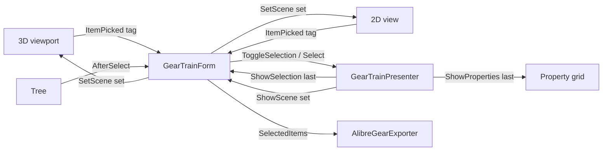

# Requirements

### Overview & Goals
The `GearTrainForm` editor can select only one gear, shaft or belt at a time. Rework the 3D (and shared 2D) view so several parts can be selected, replace the scattered Alibre export menu items with **Export selected to Alibre** and **Export all to Alibre**, and drop the three `Include ... in assembly export` options because the export now adds everything it needs.

### Scope
**In scope**
- Multi-selection of gears, racks, worms, pulleys, belts and shafts/carriers in the 3D view and the 2D view; every selected part is highlighted.
- The property grid and parameter tables show the **last selected** item.
- File menu: `Export selected to Alibre…` and `Export all to Alibre…` replace `Export gear to Alibre…`, `Export shaft or carrier to Alibre…`, `Export Assembly to Alibre` and the three `Include ...` check items; the two Cycloidal-menu export items are removed (the new File items cover cycloidal gears).
- `AssemblyExportOptions` is removed; shafts, planetary carriers and belts are exported automatically.
- Tests and Writerside topics updated.

**Out of scope**
- Multi-select in the tree view (WinForms `TreeView` is single-select; a tree click replaces the selection).
- Edit commands (`Remove selected`, add gear, mate, fit profile shift) keep acting on the last-selected item only.
- Changes to STL/OBJ export or gear geometry.

### User Stories
- As a designer, I want to click several parts in the 3D view so that I can pick exactly the parts I want in Alibre.
- As a designer, I want the properties table to follow the part I clicked last so that I can edit it while others stay highlighted.
- As a designer, I want one `Export all to Alibre` command so that I get a complete assembly without ticking Include options.

### Functional Requirements
- **Selection gesture:** every click on a part in the 3D or 2D view toggles it in or out of the selection (no modifier key). Clicking empty space does nothing. Selecting a tree node replaces the selection with that one item.
- **Last selected:** the last item added is the one shown in the property grid, the parameter tables, the tree highlight and used by the edit commands. Toggling it off makes the previously selected item the last one; an empty selection clears the grid.
- **Export selected to Alibre…**
  - Nothing selected: message "Select one or more parts first."
  - One item: exported directly as one Alibre part (current single-export behaviour for each type).
  - Two or more items: a dialog offers **Save Separate Parts**, **Save Assembly** and Cancel. Separate parts exports each item as its own new part (a failure is reported and the rest continue). Save Assembly creates one new assembly containing only the selected gears, shafts/carriers and belts at their train positions.
- **Export all to Alibre…:** always one new assembly with every gear, every exportable shaft (a shaft that only carries a rack is skipped), every planetary carrier and every timing belt. An assembly needs at least two parts in total.
- Disabled outside Alibre, as today.

# Technical Design

### Current Implementation
- `GearsUI\Gui\Presenters\GearTrainPresenter.cs`: `Selected` (single object, set in ~15 commands), `Select(tag)` (updates `ShowSelection`, `ShowProperties(CreateProperties(Selected))`, `ShowScene`), `RemoveSelected()`.
- `GearsUI\Gui\Views\IGearTrainView.cs`: `ShowScene(AssemblyScene, object selectedTag, ISet<GearComponent>)`.
- `GearsUI\Gui\Views\GearTrainForm.cs`: private `_selected`, `RenderScene()` passes it to `_viewport.SetScene` and `_view2D.SetScene`; `_viewport.ItemPicked` and `_view2D.ItemPicked` call `_presenter.Select`; `ExportSelectedGearToAlibre()` switches on `_selected`; `ExportAssemblyToAlibre()` builds `AssemblyExportOptions` from three check items; Alibre items sit in `ddFile` and in `menuCycloidal`; `AlibreExporter` setter enables them.
- `GearsUI\Gui\HelixAssemblyViewport.cs` and `GearScene2DControl.cs`: highlight with `ReferenceEquals(selected, tag)`; click raises `ItemPicked(tag)` for the first hit.
- `Gears\Calculator\Alibre\AlibreGearExporter.cs`: `ExportAssembly(train, name, AssemblyExportOptions)`, `GetAssemblyParts(train)` (throws below 2 gears), `GetShaftAssemblyParts(train, options)`, `GetBeltAssemblyParts(train, options)`; `AssemblyExportOptions` lives in `ShaftPartSketch.cs`.

### Key Decisions
- **Presenter owns the selection set** (user choice); `Selected` stays and means "last selected", so the property grid, parameter tables and edit commands need no change.
- **Click always toggles** (user choice); tree selection replaces.
- **Export prompt** offers `Save Separate Parts` / `Save Assembly` (user choice); a single selected item skips the prompt because a one-part assembly is not allowed.
- **Exporter takes an optional selection** instead of options: `null` means everything, so `Export all` and the selected assembly share one code path and shafts, carriers and belts are always included automatically.
- `Selected` keeps a setter that replaces the selection with one item, so the ~15 existing `Selected = x` assignments keep working unchanged.

### Architecture Diagram


### Proposed Changes
1. **Presenter:** back `Selected` with a `List<object> _selection`; expose `IReadOnlyList<object> SelectedItems`; add `ToggleSelection(object tag)` (ignore anything that is not a `Shaft`, `GearComponent` or `TimingBelt`); `Select(tag)` keeps replace semantics; both publish through one private method that calls `ShowSelection(Selected)`, `ShowProperties(CreateProperties(Selected))` and `ShowScene(Scene, SelectedItems, _hidden)`. After a refresh or load, drop items no longer in `Assembly`.
2. **View contract:** change `ShowScene` to `ShowScene(AssemblyScene scene, IReadOnlyCollection<object> selectedItems, ISet<GearComponent> hiddenGears)`; update every `FakeView` in `UnitTests`.
3. **Viewport and 2D control:** `SetScene(..., IReadOnlyCollection<object> selectedItems, ...)`; highlight when any selected item is reference-equal to the tag; picking is unchanged (it already reports the tag), the form decides to toggle.
4. **Form:** keep `_selected` as the last item and add `_selectedItems`; `_viewport.ItemPicked` and `_view2D.ItemPicked` call `_presenter.ToggleSelection`; refactor the type switch of `ExportSelectedGearToAlibre` into `ExportItemToAlibre(object item)`; add `ExportSelectedToAlibre()` and `ExportAllToAlibre()`; add a small `ExportChoiceDialog` (Save Separate Parts / Save Assembly / Cancel) in `GearsUI\Gui\Views`.
5. **Menus:** in `BuildLayout()` replace the six Alibre items in `ddFile` with `_btnExportSelected` and `_btnExportAll`; remove the three Alibre items from `menuCycloidal`; update the `AlibreExporter` setter and tooltips.
6. **Exporter:** delete `AssemblyExportOptions`; add an optional `IReadOnlyCollection<object> selection = null` parameter to `ExportAssembly`, `GetAssemblyParts`, `GetShaftAssemblyParts`, `GetBeltAssemblyParts`. With `null` return everything (all gears, exportable shafts and carriers, all belts); with a selection return only those items. Move the "at least two parts" check into `ExportAssembly` and count gears, shafts and belts together.

### Data Models / Contracts
```csharp
// GearTrainPresenter
public object Selected { get; private set; }                 // last selected, null when empty
public IReadOnlyList<object> SelectedItems { get; }          // in click order
public void Select(object tag);                              // replaces the selection
public void ToggleSelection(object tag);                     // adds or removes one item

// IGearTrainView
void ShowScene(AssemblyScene scene, IReadOnlyCollection<object> selectedItems, ISet<GearComponent> hiddenGears);

// AlibreGearExporter
public IADAssemblySession ExportAssembly(GearAssembly train, string assemblyName = DefaultAssemblyName, IReadOnlyCollection<object> selection = null);
public static IReadOnlyList<KeyValuePair<GearComponent, Transform3D>> GetAssemblyParts(GearAssembly train, IReadOnlyCollection<object> selection = null);
public static IReadOnlyList<KeyValuePair<Shaft, Transform3D>> GetShaftAssemblyParts(GearAssembly train, IReadOnlyCollection<object> selection = null);
public static IReadOnlyList<KeyValuePair<TimingBelt, Transform3D>> GetBeltAssemblyParts(GearAssembly train, IReadOnlyCollection<object> selection = null);
```

### File Structure
- Modified: `GearsUI\Gui\Presenters\GearTrainPresenter.cs`, `GearsUI\Gui\Views\IGearTrainView.cs`, `GearsUI\Gui\Views\GearTrainForm.cs`, `GearsUI\Gui\HelixAssemblyViewport.cs`, `GearsUI\Gui\GearScene2DControl.cs`, `Gears\Calculator\Alibre\AlibreGearExporter.cs`, `Gears\Calculator\Alibre\ShaftPartSketch.cs`.
- Added: `GearsUI\Gui\Views\ExportChoiceDialog.cs`, `UnitTests\TestMultiSelection.cs`.
- Modified tests/docs: every `FakeView` in `UnitTests` (e.g. `TestGearTrain.cs`, `TestCycloidalGear.cs`, `TestGearAdjustments.cs`, `TestCrossedHelicalMesh.cs`, `TestHtdBeltAndExport.cs`), `TestGearScene2D.cs`, `TestAlibreAssemblyExport.cs`, `Writerside\topics\gear-assemblies.md` and any topic that mentions the Include options or the old export items.

### Risks
- Changing `ShowScene` touches many test fakes; compile errors guide the update.
- Clicking empty space does not clear the selection, so users deselect by toggling parts; a tree click also resets it.
- `Remove selected` acts only on the last-selected item while several are highlighted; the status message and tooltip should say so.
- A selected assembly may contain a part that cannot be exported (for example a spiral bevel gear); `ExportAssembly` reports it before Alibre starts, and separate-parts export lists the skipped items.
- Alibre calls cannot be run in tests; keep logic in the static `Get*Parts` methods so it stays unit-testable.

# Testing

### Validation Approach
Build the solution and run the `UnitTests` project. Alibre-dependent code is checked through the static part-selection methods and by reading the menu wiring in `BuildLayout()`.

### Key Scenarios
- `ToggleSelection` adds items in order, removes on a second toggle, and `Selected` is always the last remaining item (null when empty).
- `Select` replaces a multi-selection with one item.
- The property view (`FakeView.Properties`) shows the last selected item, and after toggling it off shows the previous one.
- `ShowScene` receives all selected items.
- `GetShaftAssemblyParts`/`GetBeltAssemblyParts` with `null` return all exportable shafts, the carrier and all belts; with a selection return only the selected ones; a rack-only shaft is skipped.
- `ExportAssembly` argument checks reject fewer than two parts in total.

### Edge Cases
- Toggling a belt or shaft; selecting an item and then removing it (the selection is pruned after refresh).
- Planetary train: carrier included in `Export all`, selectable on its own.
- Selected set containing an unexportable gear.

### Test Changes
- Add `UnitTests\TestMultiSelection.cs`.
- Update every `FakeView` for the new `ShowScene` signature and `TestGearScene2D.cs` for the new `SetScene` signature.
- Rework `GetShaftAssemblyParts_FollowsTheOptions` and the belt-parts tests in `TestHtdBeltAndExport.cs` for the selection parameter; adjust the gear-count test of `GetAssemblyParts`.

# Delivery Steps

### ✓ Step 1: Add multi-selection to the presenter and view contract
`GearTrainPresenter` tracks a set of selected items with the last one as `Selected`, and the view contract passes the set to `ShowScene`.

- In `GearTrainPresenter.cs` back `Selected` with a list, add `SelectedItems` and `ToggleSelection`, route `Select` and `ToggleSelection` through one publish method, and prune stale items after refresh and load.
- Change `IGearTrainView.ShowScene` to take `IReadOnlyCollection<object> selectedItems`.
- Update all `FakeView` classes in `UnitTests`.
- Add `UnitTests\TestMultiSelection.cs` covering toggling, replace, last-selected properties and pruning.

### ✓ Step 2: Highlight and toggle multiple parts in the 3D and 2D views
Every selected part is highlighted in both views and a click toggles it.

- Change `HelixAssemblyViewport.SetScene` and `GearScene2DControl.SetScene` to take the selected set and highlight every member.
- In `GearTrainForm` store the set from `ShowScene`, pass it in `RenderScene()`, and connect `_viewport.ItemPicked` and `_view2D.ItemPicked` to `_presenter.ToggleSelection`; keep the tree on `Select`.
- Update `TestGearScene2D.cs` for the new signature.

### ✓ Step 3: Remove Include options and make the Alibre assembly export selection-aware
`AlibreGearExporter` exports shafts, carriers and belts automatically and can restrict an assembly to a selection.

- Delete `AssemblyExportOptions` from `ShaftPartSketch.cs`.
- Add the optional `selection` parameter to `ExportAssembly`, `GetAssemblyParts`, `GetShaftAssemblyParts` and `GetBeltAssemblyParts`; with `null` include everything.
- Move the two-part minimum into `ExportAssembly` and count all part kinds.
- Rework the affected tests in `TestAlibreAssemblyExport.cs` and `TestHtdBeltAndExport.cs`.

### ✓ Step 4: Replace the Alibre menu items with Export selected and Export all
The File menu offers `Export selected to Alibre…` and `Export all to Alibre…`, and the Include items are gone.

- Remove the old Alibre items from `ddFile` and `menuCycloidal`, and the three Include check items.
- Add `_btnExportSelected` and `_btnExportAll`, enabled through the `AlibreExporter` setter, with tooltips.
- Refactor the export type switch into `ExportItemToAlibre(object item)`; implement `ExportSelectedToAlibre()` (single item direct, several via the new `ExportChoiceDialog`) and `ExportAllToAlibre()`.
- Add `GearsUI\Gui\Views\ExportChoiceDialog.cs` with Save Separate Parts, Save Assembly and Cancel.

### ✓ Step 5: Update documentation and verify
The docs describe multi-select and the new export items, and the solution builds with all tests passing.

- Update `Writerside\topics\gear-assemblies.md` and any topic that mentions the Include options or the old export item names (narrow grep over `Writerside`).
- Build the solution and run `UnitTests`.