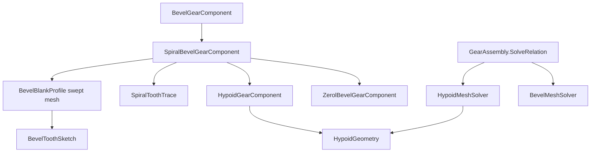

# Requirements

### Overview & Goals
The application models straight bevel gears only (`BevelGearComponent`, Standard and Gleason proportions, Tredgold back-cone tooth sketch, every tooth line runs to the cone apex). This change reviews the geometry of **spiral**, **zerol** and **hypoid** bevel gears and adds them to the model, the mesh solvers, the 3D render, the editor and the file format. Straight bevel gears stay as they are.

### Geometry review (what differs from a straight bevel)
- **Spiral bevel**: the tooth trace is a circular arc (face-mill cutter of radius `rc`) instead of a cone element. The mean spiral angle `βm` (typically 35°) is measured at the mean cone distance `Rm = Re - b/2`. The spiral angle varies along the face: `sin β(R) = (R² + rc² - R0²) / (2 R rc)`, with the cutter centre at `R0² = Rm² + rc² - 2 Rm rc sin βm` from the apex. The angular position of the trace seen from the apex is `cos φ(R) = (R² + R0² - rc²) / (2 R R0)`. The twist of a section at cone distance `R` about the gear axis is `(φ(R) - φ(Rm)) · sin δ`. Pinion and gear have opposite hands and the same `βm`, `rc` and normal module. The teeth overlap, so the face contact ratio is above 1.
- **Zerol bevel**: the same arc trace with `βm = 0`. The tooth is curved but its tangent at the mean point is a cone element, so the pitch cones, the pinion/gear cone angles and the thrust behave like a straight bevel. The spiral angle at heel and toe is small and non-zero.
- **Hypoid**: spiral teeth on shafts that do not intersect (offset `E`, usually 90° shaft angle). The pitch surfaces are tangent at the mean point only, the cone apexes do not coincide, and the pinion and gear have **different spiral angles** (`β1 > β2`, `β1 - β2 ≈ offset angle ε` with `sin ε ≈ E / r2`). Equal normal pitch at the mean point gives the pitch radius ratio `r1 / r2 = (z1 cos β2) / (z2 cos β1)`, so the pinion is larger than its tooth count suggests. Pinion and gear cone angles come from the tangency of the two pitch cones at the mean point and are solved numerically. The speed ratio stays `z2 / z1`.
- **Normal and transverse pressure angle**: spiral teeth use a normal pressure angle `αn`. The back-cone sketch is a transverse profile, so `tan αt = tan αn / cos βm`.

### Scope
**In scope**
- New gear types `SpiralBevelGearComponent`, `ZerolBevelGearComponent` and `HypoidGearComponent`, each with its own mesh pairing rules.
- Tooth rendering by sweeping the existing back-cone valley profile along the circular-arc tooth trace (several sections between heel and toe).
- Mesh solving: spiral and zerol pairs on intersecting shafts; hypoid pairs with a shaft offset.
- New relation setting for the hypoid offset; save/load of the new gear types and fields.
- Editor support to add and edit the three types; documentation of the geometry; tests.

**Out of scope**
- The face-milled cutter generation model (cutter tilt, swivel, machine settings) and real Gleason/Klingelnberg basic settings.
- Alibre export of the curved teeth (the export declines these types with a clear message).
- Contact pattern, load capacity and strength calculations.
- Changes to straight (Standard and Gleason) bevel gears or to the helical, worm and cycloidal meshes.

### User Stories
- As a designer, I want to add a spiral bevel pair with a spiral angle and hand so that I see curved teeth meshing in 3D.
- As a designer, I want a zerol pair so that I can model curved-tooth gears with the thrust of a straight bevel.
- As a designer, I want a hypoid pair with a shaft offset so that I see the offset shafts and the larger pinion.

### Functional Requirements
- A spiral pair (e.g. 18/36, m 4, 35° right/left hand) solves with opposite hands and renders curved teeth. The twist is zero at mid face, so the phase at mid face equals the straight-bevel phase.
- A zerol pair solves and renders curved teeth with a straight-bevel placement.
- A hypoid pair solves for a given offset; the pinion pitch radius, both cone angles and both spiral angles satisfy the relations above, and the shafts are offset by `E`.
- Pairing is validated: same family, equal module, pressure angle, cutter radius, opposite hands, matching `βm` (spiral/zerol); hypoid requires a non-zero offset and consistent hand/offset side. Messages state the expected value.
- Older files load unchanged; straight bevel render output is unchanged.

### Non-Functional Requirements
- Geometry code stays separate from UI code (project guideline). Mesh size stays reasonable: about 8 sections between heel and toe.

# Technical Design

### Current Implementation
- `Gears\Model\Assemblies\BevelGearComponent.cs`: concrete class with `Teeth`, `MateTeeth`, `ShaftAngleDeg`, `BevelType` (Standard/Gleason), cone angle, `ApexAxialPosition`, `Validate`, `BuildGeometry`. The face is centred on the Z = 0 mid-plane with the apex on +Z. Most members are not virtual.
- `Gears\Calculator\BevelBlankProfile.cs`: blank sketch (points A to I). `BuildToothedMesh` builds only a **heel ring and a toe ring** (`ToToe` scales about the apex pointB), so every tooth line is straight.
- `Gears\Calculator\BevelToothSketch.cs`: valley sketch on the developed back cone (involute flanks, trochoidal fillets, optional rack tip radius, backlash, Gleason profile shift). Reused as is.
- `Gears\Calculator\Assemblies\BevelMeshSolver.cs`: requires `BevelGearComponent`, sets `MateTeeth`, `ShaftAngleDeg`, `BevelType` on both, and returns a `DrivenFrame` placing both apexes together. `MeshSolvers.cs` maps `MeshType` to solvers. `ICrossedAxisSolver` (from the crossed helical work) is the pattern for a solver needing an extra relation value.
- `AssemblySerializer.cs`: gear `Type` string ("Bevel") with optional fields; `RelationDto` has `ShaftAngleDeg`. `GearTrainPresenter.cs`, `TrainNodeProperties.cs`, `GearTrainForm.cs` handle bevel in the editor. `AlibreGearExporter.cs` and `BevelGearSketch.cs` export straight bevel by a heel/toe loft.

### Key Decisions
- **Subclass per type** (confirmed): `SpiralBevelGearComponent : BevelGearComponent`, `ZerolBevelGearComponent : SpiralBevelGearComponent` (mean spiral angle fixed at 0), `HypoidGearComponent : SpiralBevelGearComponent`. Needed members of `BevelGearComponent` become `virtual` (cone angle, cone distance, apex position, `CreateBlankProfile`, `BuildGeometry`, `Validate`, `TypeName`). Straight output must not change.
- **Swept Tredgold profile** (confirmed): the existing valley sketch is kept; a tooth trace gives, for each section scale along the face, a twist angle about the axis. Sections are rings between heel and toe, so the flank surfaces are ruled between neighbouring sections.
- **Spiral/zerol use `MeshType.Bevel`** with extra pairing checks in `BevelMeshSolver`; **hypoid gets `MeshType.Hypoid`** and `HypoidMeshSolver` because the placement differs (offset, apexes apart).
- The offset is a relation value, `GearMeshRelation.OffsetMm`, passed through a new `IOffsetAxisSolver` as `ICrossedAxisSolver` does for the shaft angle.
- The twist is zero at the mean section so the mesh phase logic of `BevelMeshSolver` still holds.

### Data Models / Contracts
```csharp
// Gears\Calculator\SpiralToothTrace.cs (new, pure math)
public sealed class SpiralToothTrace {
    public SpiralToothTrace(double meanConeDistance, double meanSpiralAngleRad, double cutterRadius, bool rightHand);
    public double SpiralAngleAt(double coneDistance);     // sin b = (R^2 + rc^2 - R0^2) / (2 R rc)
    public double TwistAt(double coneDistance, double pitchConeAngleRad); // (phi(R) - phi(Rm)) / sin(delta), signed by hand
    public static SpiralToothTrace Straight { get; }        // twist 0, used by straight bevels
}
// Gears\Calculator\HypoidGeometry.cs (new)
public static HypoidPair Solve(int z1, int z2, double module, double offset, double shaftAngleDeg, double pinionSpiralDeg);
// returns r1, r2, cone angles, spiral angles beta1/beta2, mean point, offset angle
public class SpiralBevelGearComponent : BevelGearComponent {
    public double MeanSpiralAngleDeg { get; set; } = 35;  // overridden to 0 in Zerol
    public double CutterRadius { get; set; }              // 0 = automatic, about the mean cone distance
    public SpiralHand Hand { get; set; }                  // Left/Right
    public double TransversePressureAngleDeg { get; }     // atan(tan(an) / cos(bm))
}
public sealed class HypoidGearComponent : SpiralBevelGearComponent {
    public double OffsetMm { get; set; }                  // set by the solver from the relation
    public bool IsPinion { get; set; }
}
// MeshType.Hypoid; GearMeshRelation.OffsetMm; IOffsetAxisSolver : IMeshSolver { Solve(driver, driven, phase, offsetMm) }
// RelationDto.OffsetMm (optional); gear types "SpiralBevel", "ZerolBevel", "Hypoid" in AssemblySerializer
```

### Proposed Changes
- `BevelBlankProfile.BuildToothedMesh(sketch, ..., trace, sections)`: for each section k the back-cone point is scaled about pointB by `s_k` (heel 1, toe `ToeScale`) and revolved by `angles[i] + TwistAt(R_k)`. A straight trace gives the present heel/toe output, so existing tests keep passing. `BuildGeometry` of the subclasses passes the trace, converts the pressure angle to transverse, and builds the 2D outline from the heel section.
- `HypoidGearComponent` takes its cone angle, mean radius and apex position from `HypoidGeometry` instead of the intersecting-shaft formula; the gear blank uses the solved cone angle, so `BevelBlankProfile` is fed an effective mate tooth count / shaft angle that reproduces it, or a cone-angle override (decide in stage 3, favouring a cone-angle constructor parameter).
- `BevelMeshSolver`: add family checks (same type, opposite hands, equal `βm`, `rc`). `HypoidMeshSolver`: place both gears so that their mean points coincide, with the driven axis offset by `E` along the common perpendicular, and return `DrivenFrame`, phase and ratio `z2/z1`.
- `GearAssembly.SolveRelation`: call `IOffsetAxisSolver` like the crossed solver; reject a centre distance override for hypoid.
- Editor: add-mate commands for Spiral, Zerol, Hypoid; properties for spiral angle, hand, cutter radius and offset; the hand of the mate is set opposite automatically.
- `AlibreGearExporter.Export`: throw a clear `NotSupportedException` for spiral/zerol/hypoid.
- Documentation: new Writerside topic with the geometry review and formulas; register it in the Writerside tree.

### File Structure
- Added: `Gears\Calculator\SpiralToothTrace.cs`, `Gears\Calculator\HypoidGeometry.cs`, `Gears\Model\Assemblies\SpiralBevelGearComponent.cs`, `ZerolBevelGearComponent.cs`, `HypoidGearComponent.cs`, `Gears\Calculator\Assemblies\HypoidMeshSolver.cs`, `IOffsetAxisSolver.cs`, tests `UnitTests\TestSpiralToothTrace.cs`, `TestHypoidGeometry.cs`, `TestSpiralBevelGears.cs`, `TestHypoidMesh.cs`, and `Writerside\topics\spiral-zerol-hypoid-bevel-gears.md`. New files need `<Compile Include>` entries in the old-style `Gears.csproj` and `UnitTests.csproj`.
- Modified: `BevelGearComponent.cs`, `BevelBlankProfile.cs`, `BevelMeshSolver.cs`, `MeshSolvers.cs`, `GearMeshRelation.cs`, `GearAssembly.cs`, `AssemblySerializer.cs`, `AlibreGearExporter.cs`, `GearTrainPresenter.cs`, `TrainNodeProperties.cs`, `GearTrainForm.cs`.

### Architecture Diagram


### Risks
- **Hypoid equations**: the cone angles and spiral angle split come from a numerical solve of the pitch-cone tangency; wrong sign conventions give a plausible but wrong pair. Mitigation: validate against a published Gleason/AGMA worked example in `TestHypoidGeometry`, plus checks that the two pitch cones are tangent at the mean point and the surface speeds match.
- **Twist sign and hand**: a wrong sign mirrors the teeth so that mating teeth collide. Mitigation: test that the pinion and gear tooth lines through the mean point have the same tangent in world coordinates, and that a mid-face section clears the mate.
- **Back-cone approximation**: the transverse profile at the heel is used along the whole face although the spiral angle varies; accuracy is approximate (the plan keeps the swept Tredgold decision). Documented as a limitation.
- **Regression**: making members virtual and adding sections must not change straight bevel meshes. Mitigation: keep `TestBevelGearTypes`, `TestBevelBlankProfile`, `TestBevelToothSketch` and the Alibre bevel tests green and compare vertex output for the straight trace.
- **Self-intersecting mesh**: a large spiral angle with few sections may fold flank surfaces. Mitigation: section count scales with the twist, and `Validate` limits `βm` (0 to 60°) and cutter radius.

# Testing

### Validation Approach
Build the solution, then run the new and the regression tests with the project test tools (UnitTests is a legacy NUnit project); check that the executed test count is non-zero and includes the new tests.

### Key Scenarios
- **Spiral trace**: `SpiralAngleAt(Rm) = βm`; twist at the mean section is 0; heel and toe angles satisfy the circle formula; a straight trace gives zero twist and a mesh identical to the present output.
- **Zerol**: `βm = 0`, cone angles and apex placement equal those of a straight pair with the same teeth; teeth are curved (non-zero twist at heel/toe).
- **Spiral pair 18/36, m 4, 35°**: opposite hands, cone angles from the 90° formula, solver frame equals the straight bevel frame, tooth tangents at the mean point agree in world coordinates.
- **Hypoid pair**: pitch radius ratio `r1/r2 = z1 cos β2 / (z2 cos β1)`, `β1 - β2` equals the offset angle, pitch cones tangent at the mean point, driven shaft offset by `E`, speed factor magnitude `z1/z2`; zero offset reduces to a spiral pair.
- **Save/load**: round trip of the three gear types, hand, cutter radius and relation offset; an older file with straight bevel loads unchanged.
- **Editor**: presenter tests (style of `TestGearTrainEditorPhases3To7.cs`) add each mate type and the mate gets the opposite hand.

### Edge Cases
- Mismatched family, hand, spiral angle, cutter radius, module or pressure angle is rejected with the expected value in the message.
- Hypoid with zero offset, offset larger than allowed by the gear radius, or a shaft angle that gives no solution is rejected.
- `βm` outside 0 to 60°, cutter radius too small for the face width, and a face width that is too large are rejected.
- Alibre export of the new types gives a clear not-supported message; straight bevel export still passes.

### Test Changes
Add `TestSpiralToothTrace`, `TestHypoidGeometry`, `TestSpiralBevelGears` and `TestHypoidMesh`. Keep green: `TestBevelGearTypes`, `TestBevelBlankProfile`, `TestBevelToothSketch`, `TestAlibreBevelExport`, `TestGearTrainPhases3To7`, `TestGearTrainEditorPhases3To7`.

# Delivery Steps

### ✓ Step 1: Implement spiral tooth trace and hypoid pair geometry
The pure geometry for the curved tooth trace and the hypoid pitch-cone solution exists and is tested.

- Add `Gears\Calculator\SpiralToothTrace.cs` with `SpiralAngleAt`, `TwistAt` (hand-signed, zero at the mean cone distance) and a `Straight` instance.
- Add `Gears\Calculator\HypoidGeometry.cs` with `Solve(...)` returning pitch radii, cone angles, spiral angles, mean point and offset angle (numerical solve of pitch-cone tangency and equal normal pitch).
- Add `UnitTests\TestSpiralToothTrace.cs` and `TestHypoidGeometry.cs` (circle formulas, zerol case, zero-offset reduction, published worked example) and register the files in `Gears.csproj` and `UnitTests.csproj`.
- Verify: build, run the new tests.

### ✓ Step 2: Render curved teeth by sweeping the back-cone profile
The bevel blank mesh can be built with curved teeth through several heel-to-toe sections, and straight bevels render exactly as before.

- Extend `BevelBlankProfile.BuildToothedMesh` with a trace and a section count: scale each section about pointB and add the trace twist when revolving.
- Keep `BevelToothSketch` unchanged; add a transverse pressure angle conversion for spiral teeth at the call site.
- Choose the section count from the total twist (about 8 by default) and guard against folded flanks.
- Add tests in `TestBevelBlankProfile.cs` or a new test: the straight trace gives output identical to the present heel/toe mesh; a spiral trace gives a watertight mesh with the expected heel/toe twist.
- Verify: build, run `TestBevelBlankProfile`, `TestBevelToothSketch`, `TestBevelGearTypes`.

### ✓ Step 3: Add spiral, zerol and hypoid gear components and file format
The three gear types can be created, validated, built to a 3D mesh and saved/loaded.

- Make the needed `BevelGearComponent` members virtual without changing straight behaviour.
- Add `SpiralBevelGearComponent` (spiral angle, hand, cutter radius, transverse pressure angle, validation), `ZerolBevelGearComponent` (angle fixed at 0) and `HypoidGearComponent` (offset, pinion flag, cone angles from `HypoidGeometry`).
- Override `BuildGeometry` to use the trace and sweep, and build the 2D outline from the heel section.
- Extend `AssemblySerializer` with the types "SpiralBevel", "ZerolBevel", "Hypoid" and their optional fields.
- Add `UnitTests\TestSpiralBevelGears.cs`: geometry values, validation messages, mesh build, round trip, old file loading.
- Verify: build, run the new tests and the bevel regression tests.

### ✓ Step 4: Add spiral/zerol pairing and the hypoid mesh solver
Spiral and zerol pairs mesh on intersecting shafts and hypoid pairs mesh on offset shafts in a solved assembly.

- Extend `BevelMeshSolver` with family, hand, spiral angle, cutter radius checks and mate configuration (opposite hand set on the mate).
- Add `MeshType.Hypoid`, `GearMeshRelation.OffsetMm`, `IOffsetAxisSolver`, `HypoidMeshSolver`, register it in `MeshSolvers.cs`, and call it from `GearAssembly.SolveRelation` (reject a centre distance override).
- Add `RelationDto.OffsetMm` as an optional field in `AssemblySerializer`.
- Place the hypoid driven gear so that the mean points coincide with the shafts offset by E; set phase and ratio `z2/z1`.
- Add `UnitTests\TestHypoidMesh.cs`: frame placement, tangent agreement at the mean point in world coordinates, speed factor, rejection messages, save/load of the offset.
- Verify: build, run the mesh and assembly tests.

### ✓ Step 5: Add editor support, export guard and documentation
Users can add and edit the new gear types in the gear train editor, export declines them clearly, and the geometry is documented.

- Add the add-mate commands for Spiral, Zerol and Hypoid in `GearTrainPresenter.cs` and `GearTrainForm.cs`, with the opposite hand set on the mate.
- Show spiral angle, hand, cutter radius and the hypoid offset in `TrainNodeProperties.cs`.
- Make `AlibreGearExporter.Export` throw a clear not-supported message for the new types.
- Add a Writerside topic with the geometry review, formulas and limitations, and register it in the Writerside tree.
- Add presenter tests in the style of `TestGearTrainEditorPhases3To7.cs`.
- Verify: build, run the editor tests, then the full `UnitTests` suite and report the executed count.